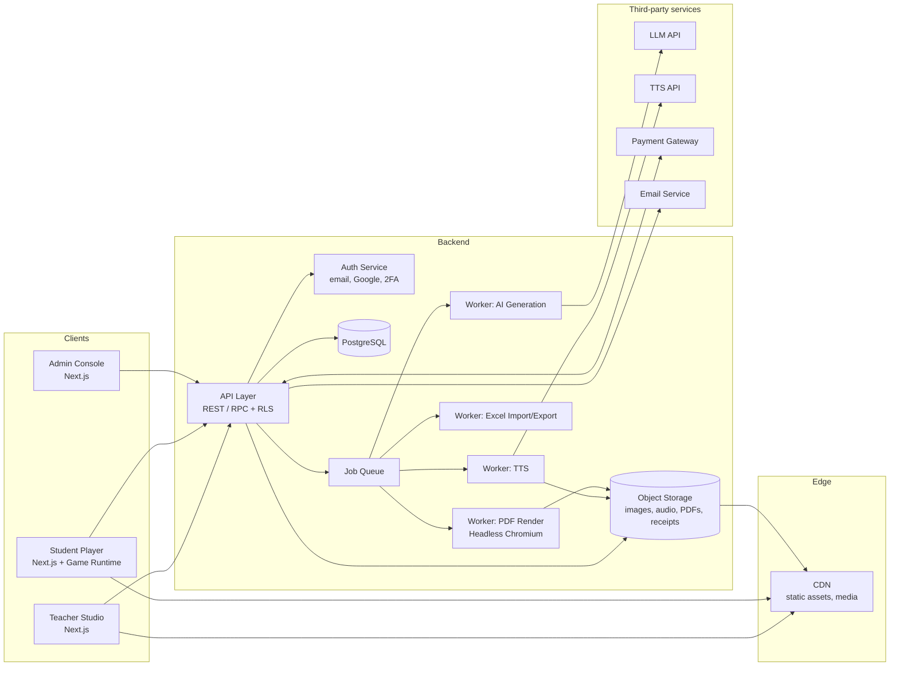
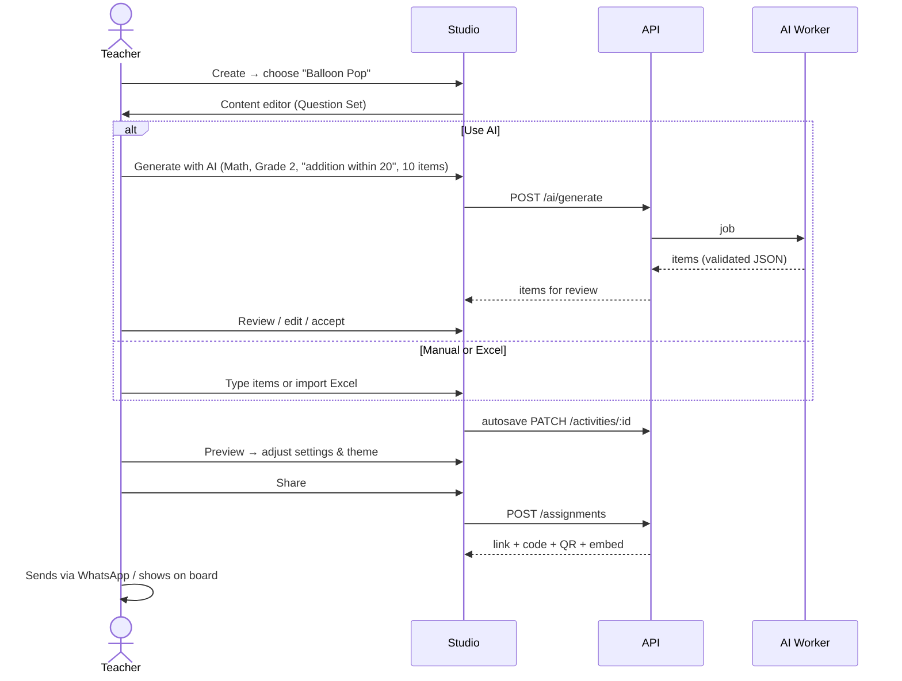
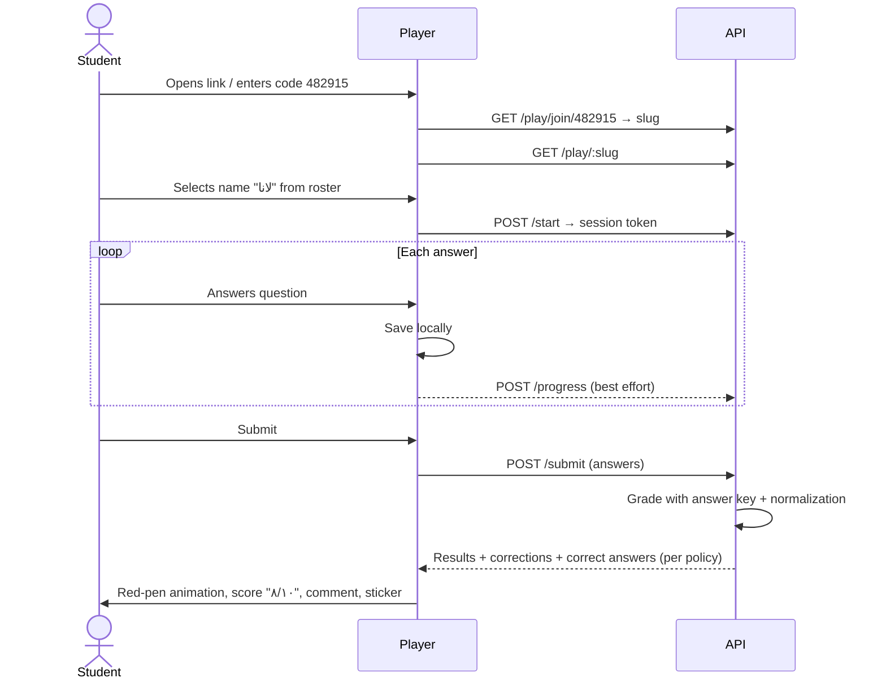
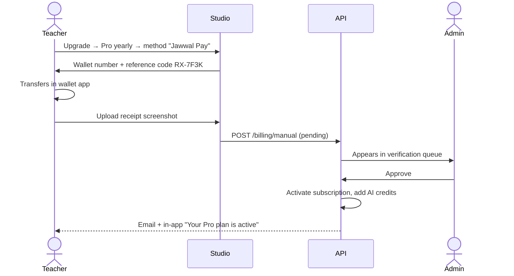

# ReemixEdu — Business Requirements Document (BRD) & Software Requirements Specification (SRS)

| Field | Value |
|---|---|
| Product | **ReemixEdu** — Interactive Educational Games & Worksheets Platform |
| Document version | 1.0 (MVP baseline) |
| Date | 7 November 2026 |
| Owner | Reem — Founder & Product Owner |
| Status | Draft for review |
| Target market (launch) | Palestine — Grades 1–6 |
| Languages | Arabic (RTL, primary) and English |

---

## Table of Contents

**Part A — Business Requirements Document (BRD)**
1. Executive Summary
2. Problem Statement & Opportunity
3. Vision, Mission & Business Objectives
4. Target Market & Personas
5. Competitive Analysis & Differentiation
6. Product Scope (MVP In / Out)
7. Business Model & Pricing
8. High-Level Business Requirements
9. Success Metrics (KPIs)
10. Assumptions, Constraints & Dependencies
11. Risks & Mitigations
12. Roadmap, Phasing & Team
13. Stakeholders & Approval

**Part B — Software Requirements Specification (SRS)**
1. Introduction
2. Overall Description
3. Core Concepts: Content Model & Template Switching
4. Functional Requirements
5. The 15 Games — Detailed Specifications
6. Interactive Worksheets & Red-Pen Correction
7. Arabic Mathematical Notation
8. Non-Functional Requirements
9. System Architecture
10. Data Model
11. API Outline
12. Key User Flows
13. Wireframes (Low-Fidelity)
14. User Stories & Acceptance Criteria (Samples)
15. Traceability Matrix
16. Open Questions & Decisions Log
17. Glossary

---

# PART A — BUSINESS REQUIREMENTS DOCUMENT (BRD)

## A1. Executive Summary

ReemixEdu is a web platform where primary-school teachers create **interactive educational games** and **self-correcting interactive worksheets** in minutes, then share them with students by link or code. It is inspired by Wordwall but goes further:

- **Arabic-first**: full RTL interface, Arabic-Indic numerals (٠١٢٣…), and properly *Arabized* mathematical notation (as produced by Arabic MathType), which no major competitor supports.
- **15 game templates**, including action games (Balloon Pop, Whack-a-Mole, Maze Chase) and a **branching story scenario** inspired by Articulate Storyline.
- **"Write once, play many"**: a teacher enters content once and switches it between compatible game templates in one click.
- **Interactive worksheets** that are graded instantly with an animated **red-pen correction**: hand-drawn ✓/✗ marks, the score written in red at the top of the page, the correct answer shown, and an encouraging sticker.
- **AI content generation** in Arabic and English, which the teacher can switch on when they want it.
- **Mobile-first**, low-bandwidth friendly, with local payment methods (bank transfer, e-wallets, Mastercard/Visa).

The MVP targets Palestinian teachers of **Arabic, Mathematics, English and Science, Grades 1–6**, using a **freemium** business model.

---

## A2. Problem Statement & Opportunity

### A2.1 Problems

| # | Problem | Who feels it |
|---|---|---|
| P1 | Existing tools (Wordwall, Kahoot, Liveworksheets) are English-first. Arabic RTL support is partial, and Arabic math notation (mirrored expressions, Arabic-Indic digits, Arabic variable letters) is **not supported at all**. | Arabic & Math teachers |
| P2 | Teachers spend hours preparing engaging activities. Desktop authoring tools such as Articulate Storyline are expensive, complex and built for instructional designers, not classroom teachers. | All teachers |
| P3 | Printed worksheets give delayed feedback. Students wait days to learn what they got wrong, and teachers spend evenings marking. | Teachers, students |
| P4 | International subscriptions are priced in USD and paid only by international card, which many Palestinian teachers do not have or prefer not to use. | Teachers in Palestine |
| P5 | Many students use low-end Android phones with intermittent connectivity, and heavy platforms load slowly or fail. | Students |

### A2.2 Opportunity

- A gap for an **Arabic-native, curriculum-friendly** interactive content platform, starting with Palestine and expandable to the wider Arab region.
- Teacher-led growth: every shared activity exposes students (and other teachers) to the brand.
- AI lowers content-creation effort sharply, which is a strong reason to upgrade to paid plans.

---

## A3. Vision, Mission & Business Objectives

**Vision:** Make learning joyful for every Arab child by giving every teacher a playful, Arabic-native toolbox.

**Mission:** Let a teacher turn any lesson into a game or a self-correcting worksheet in under 5 minutes.

### A3.1 Business Objectives (SMART)

| ID | Objective | Target | Timeframe |
|---|---|---|---|
| BO-1 | Launch a production MVP | Live with 15 games + worksheets | Month 6 from kickoff |
| BO-2 | Teacher acquisition | 1,500 registered teachers | 6 months post-launch |
| BO-3 | Activation | ≥ 40% of registered teachers create an activity played by ≥ 5 students | Rolling 30 days |
| BO-4 | Monetization | ≥ 5% free-to-paid conversion | 6 months post-launch |
| BO-5 | Student engagement | ≥ 80% of started plays are completed | From launch |
| BO-6 | Retention | ≥ 35% of activated teachers active in month 2 | From launch |

---

## A4. Target Market & Personas

### A4.1 Market Segmentation

| Segment | Description | MVP priority |
|---|---|---|
| Primary | Individual teachers, Grades 1–6, government, UNRWA and private schools in Palestine | **High** |
| Secondary | Private tutors and learning centers | Medium |
| Future | School-wide licenses, Arab region expansion (Jordan, Gulf), parents | Post-MVP |

### A4.2 Personas

**Persona 1 — "Ms. Reem", Math teacher, Grade 3 (Primary user)**
- Teaches 2–3 sections, uses her phone more than a laptop, sometimes has a smart board.
- Needs: Arabic math notation that looks like the textbook, quick game creation, and results per student.
- Frustrations: Wordwall shows math wrongly in Arabic; preparing worksheets takes too long.

**Persona 2 — "Mr. Ahmad", English teacher, Grade 5**
- Needs: word games (Word Search, Unjumble, Rocket Rescue), audio pronunciation, and an English interface for activities.

**Persona 3 — "Lana", Student, Grade 2 (Player)**
- Plays on a parent's phone, cannot read long instructions, and loves sounds and stickers.
- Needs: very simple joining (code + name), audio read-aloud, big touch targets, instant feedback.

**Persona 4 — "Platform Admin" (Operator)**
- Needs to verify bank and wallet payments, activate subscriptions, manage users and coupons, and monitor AI usage costs.

---

## A5. Competitive Analysis & Differentiation

| Capability | Wordwall | Kahoot | Liveworksheets | Quizizz (Wayground) | Articulate Storyline | **ReemixEdu** |
|---|---|---|---|---|---|---|
| Target user | Teachers | Teachers | Teachers | Teachers | Instructional designers | **Teachers** |
| Template switching | ✓ | ✗ | ✗ | Partial | ✗ | **✓** |
| Number of game templates | 30+ | Few | — | Few | Unlimited (manual build) | **15 (MVP)** |
| Interactive worksheets | Partial | ✗ | ✓ | ✓ | Manual | **✓ with red-pen correction** |
| Branching scenarios | ✗ | ✗ | ✗ | ✗ | ✓ | **✓ (simplified)** |
| Full Arabic RTL UI | Partial | Partial | Partial | Partial | Partial | **✓ native** |
| Arabic math notation + Arabic-Indic numerals | ✗ | ✗ | ✗ | ✗ | ✗ | **✓ (key differentiator)** |
| AI generation in Arabic | Limited | ✓ | ✗ | ✓ | AI assistant | **✓ curriculum-aware prompts** |
| Teacher voice recording | ✓ | ✗ | ✓ | ✓ | ✓ | **✓** |
| Local payment (Palestine) | ✗ | ✗ | ✗ | ✗ | ✗ | **✓** |
| Price for teacher | USD subscription | USD subscription | Freemium | Freemium | Expensive license | **Low, local currency** |

> Note: competitor capabilities change frequently; this table reflects general positioning and should be re-validated before marketing use.

### A5.1 Unique Value Proposition

> **"The only Arabic-native platform where teachers create games and self-correcting worksheets, with real Arabic math, in five minutes, from their phone."**

### A5.2 Differentiators (ranked)
1. Arabic math notation and Arabic-Indic numerals that look like the textbook.
2. Red-pen worksheet correction, an emotional, familiar experience for children and parents.
3. Mobile-first, lightweight performance for low-end devices and weak networks.
4. Local payments and local pricing.
5. Storyline-style branching story games without authoring complexity.
6. AI generation tuned for Palestinian Grades 1–6 subjects.

---

## A6. Product Scope

### A6.1 In Scope — MVP

| Area | Included |
|---|---|
| Users | Teacher, Student (anonymous join), Admin |
| Teacher accounts | Email/password + Google sign-in, profile, plan status |
| Activity creation | Content editor by content type; 15 game templates; template switching; themes; game settings |
| Worksheets | Built in-platform; 8 auto-gradable question types; red-pen correction; PDF print export |
| Media | Image upload, image library, Arabic/English text-to-speech, teacher voice recording, interactive sound effects |
| Arabic math | Visual math editor + renderer for the Grades 1–6 subset; Arabic-Indic numerals |
| AI | Optional AI generation of questions and content (with credits) |
| Import | Excel (.xlsx) import with downloadable templates |
| Sharing | Link, 6-digit code, QR code, iframe embed |
| Assignments | Deadline, attempts, shuffle, show-answers policy, optional class roster |
| Reports | Per-student and per-question results, most-missed questions, Excel export |
| Monetization | Freemium plans, card payment gateway, e-wallet/bank transfer with admin verification, coupons |
| Admin | User, subscription, payment, coupon, asset and AI-usage management; basic analytics |
| Localization | Arabic & English UI; activity language set per activity |

### A6.2 Out of Scope — MVP (Future Phases)

| Item | Phase |
|---|---|
| Live multiplayer mode (Kahoot-style) | Phase 3 |
| Open-ended questions with manual teacher grading | Phase 2 |
| Upload PDF and overlay answer boxes (Liveworksheets-style) | Phase 2 |
| Google Classroom / Microsoft Teams integration | Phase 2 |
| SCORM / xAPI export for LMS | Phase 3 |
| School / district licenses and school admin role | Phase 2 |
| Parent accounts and parent reports | Phase 3 |
| Public community library and marketplace | Phase 2 |
| Native mobile apps | Phase 3 |
| Additional games beyond 15 | Continuous |
| Full offline mode (PWA play caching beyond basic resilience) | Phase 2 |

---

## A7. Business Model & Pricing

### A7.1 Freemium Plans (initial proposal — to be validated)

| Feature | **Free** | **Pro Teacher** | **School** (Phase 2) |
|---|---|---|---|
| Activities (games + worksheets) | 5 | Unlimited | Unlimited per teacher |
| Game templates | All 15 | All 15 | All 15 |
| Student plays per activity / month | 100 | Unlimited | Unlimited |
| AI generations / month | 5 | 300 | Pooled |
| Results storage | 30 days | 12 months | 12 months+ |
| Excel export of results | ✗ | ✓ | ✓ |
| PDF print of worksheets | With watermark | ✓ no watermark | ✓ |
| Teacher voice recording | ✓ | ✓ | ✓ |
| Custom themes & mascot toggle | Basic | ✓ | ✓ |
| Embed in other sites | ✓ (with branding) | ✓ (no branding) | ✓ |
| Indicative price | 0 | ~20 ILS / month or ~160 ILS / year | Quote |

> Prices are placeholders for market validation (survey + pilot with 30–50 teachers). Display in ILS with optional USD/JOD.

### A7.2 Payment Methods (Palestine)

| Method | Flow | MVP |
|---|---|---|
| Mastercard / Visa (online) | Through a payment gateway that operates in Palestine (candidate: Lahza; also evaluate bank-provided e-commerce gateways such as Bank of Palestine) with automatic activation via webhook | ✓ |
| E-wallets (Jawwal Pay, PalPay "Mahfazati") | Teacher transfers to the merchant wallet, uploads the reference/receipt, and the admin verifies and activates. Upgrade to API integration when merchant APIs are available | ✓ (manual verification) |
| Bank transfer | Teacher transfers and uploads the receipt; the admin verifies and activates | ✓ (manual verification) |
| Coupon / voucher codes | For promotions, pilots and resellers (bookshops, training centers) | ✓ |

Context: the Palestine Monetary Authority (PMA) has licensed several e-payment companies offering e-wallets and e-cards ([Monshati](https://monshati.ps/en/page/e-companies)). Jawwal Pay is a PMA-regulated, PCI-compliant wallet that offers a virtual Mastercard for online shopping ([App Store listing](https://apps.apple.com/us/app/jawwal-pay/id1495191874)). PalPay runs the licensed "Mahfazati" e-wallet and offers e-commerce solutions ([PalPay](https://www.palpay.ps/en/who-we-are)). Lahza exposes a developer payment API ([integration package](https://packagist.org/packages/lahza/payment-gateway)). **Merchant onboarding terms, fees, supported currencies (ILS/USD/JOD) and API availability must be confirmed directly with each provider before development.**

### A7.3 Revenue Streams
1. Pro Teacher subscriptions (core).
2. School licenses (Phase 2).
3. Premium content packs aligned to the Palestinian curriculum (Phase 2).
4. Teacher training workshops and certification (optional, offline).

### A7.4 Cost Drivers
- Cloud hosting, database and storage (images, audio).
- AI API usage (generation + TTS), controlled by credits.
- Payment gateway fees.
- Design assets (illustrations, mascot, sounds) — one-time + ongoing.
- Marketing (teacher communities, Facebook groups, school pilots).

---

## A8. High-Level Business Requirements

| ID | Business Requirement | Priority |
|---|---|---|
| BR-01 | Teachers shall create an interactive game from their own content in under 5 minutes. | Must |
| BR-02 | The platform shall provide 15 distinct game templates. | Must |
| BR-03 | Content entered once shall be reusable across compatible templates (template switching). | Must |
| BR-04 | Teachers shall create interactive worksheets that are auto-graded instantly with a red-pen correction experience. | Must |
| BR-05 | Students shall join with a link/code and their name only, with no account or email. | Must |
| BR-06 | The platform shall fully support Arabic RTL and English LTR, per interface and per activity. | Must |
| BR-07 | Arabic activities shall support Arabized math notation and Arabic-Indic numerals. | Must |
| BR-08 | Teachers shall optionally use AI to generate activity content. | Must |
| BR-09 | Activities shall support images, text-to-speech, recorded voice and interactive sounds. | Must |
| BR-10 | Teachers shall import content from Excel. | Must |
| BR-11 | Teachers shall view per-student and per-question results and export them to Excel. | Must |
| BR-12 | Worksheets shall be exportable to PDF for printing. | Must |
| BR-13 | The platform shall operate a freemium model with local payment options. | Must |
| BR-14 | The platform shall be mobile-first and usable on phones, tablets, desktops and smart boards. | Must |
| BR-15 | Activities shall be shareable by link, QR and embed code. | Must |
| BR-16 | Admins shall manage users, subscriptions, payments, coupons and assets. | Must |
| BR-17 | The platform shall collect minimal student data and protect children's privacy. | Must |
| BR-18 | Game settings (timer, attempts, points, leaderboard, sounds, mascot) shall be configurable and switchable off. | Must |

---

## A9. Success Metrics (KPIs)

| Category | KPI | Target |
|---|---|---|
| Acquisition | New teacher signups / month | 250+ after month 2 |
| Activation | % teachers whose first activity is played by ≥ 5 students within 7 days | ≥ 40% |
| Creation speed | Median time from "Create" to "Share" | < 5 minutes |
| Engagement | Plays per active teacher / week | ≥ 30 |
| Completion | Completed plays / started plays | ≥ 80% |
| Conversion | Free → Pro | ≥ 5% |
| Retention | Month-2 teacher retention | ≥ 35% |
| Quality | Crash-free sessions | ≥ 99.5% |
| Performance | Game ready time on mid-range Android over 4G | < 3 s |
| Satisfaction | Teacher NPS | ≥ 40 |

---

## A10. Assumptions, Constraints & Dependencies

### A10.1 Assumptions
- Teachers have a smartphone and intermittent internet; many students play at home on a parent's phone.
- Teachers will pay a modest monthly fee in local currency for unlimited use + AI.
- Initial content is created by teachers; no curated library is required at launch (a small set of sample activities will be provided).

### A10.2 Constraints
- **Connectivity**: intermittent networks and power cuts mean lightweight assets and resumable plays are required.
- **Devices**: low-end Android phones dominate, so the platform must avoid heavy 3D and use progressive loading.
- **Payments**: international payment processors may be unavailable, so local gateways and manual verification are needed.
- **Legal**: there is currently no enacted comprehensive Palestinian personal-data protection law. Rights organizations report that a comprehensive law meeting international standards has not yet been issued ([IFEX](https://ifex.org/?p=334625), [7amleh](https://7amleh.org/post/1227)), while a personal-data protection decree-law has been on the government's legislative agenda ([Al-Quds](https://www.alquds.com/en/posts/165704)). Status must be re-checked before launch. ReemixEdu will therefore **voluntarily align with GDPR and COPPA principles** (data minimization, no student email, no behavioral advertising) and monitor local legislation.
- **Timeline**: MVP in about 6 months.

### A10.3 Dependencies
- Payment gateway merchant account approval.
- AI provider (LLM) and TTS provider with acceptable Arabic quality.
- Illustrator/sound designer for mascot, game art and sound effects.
- Cloud hosting provider.

---

## A11. Risks & Mitigations

| ID | Risk | Likelihood | Impact | Mitigation |
|---|---|---|---|---|
| R1 | Arabic math rendering is technically hard (mirroring, vertical arithmetic, long division) | High | High | Technical spike in Sprint 1; build a focused renderer for the Grades 1–6 subset only; render to SVG for consistency |
| R2 | Low willingness to pay | Medium | High | Pilot pricing; annual discount; coupons through schools; strong free tier to drive virality |
| R3 | Payment gateway approval delays | Medium | Medium | Launch with bank/wallet manual verification + coupons; add card gateway when approved |
| R4 | Poor Arabic TTS pronunciation (missing diacritics) | High | Medium | Teacher voice recording; allow teacher to add diacritics for TTS; preview before saving |
| R5 | AI generates wrong or unsuitable content | Medium | High | Teacher must review before publishing; schema validation; content filters; grade-level prompts |
| R6 | AI costs exceed revenue | Medium | Medium | Monthly credits per plan; caching; cheaper models for simple tasks |
| R7 | Performance on low-end phones | Medium | High | Performance budgets; lazy-load game engines; asset compression; test on real low-end devices |
| R8 | Scope creep (15 games is large) | High | High | Shared game engine & content model; strict MVP; games delivered in 3 waves |
| R9 | Connectivity interruptions during play | High | Medium | Local progress saving; retry queue for result submission |
| R10 | Copyright issues with images uploaded by teachers | Low | Medium | Terms of use; report/takedown process; built-in royalty-free library |
| R11 | Children's privacy concerns | Low | High | No student accounts; first name only; data retention limits; clear privacy policy in Arabic |

---

## A12. Roadmap, Phasing & Team

### A12.1 MVP Timeline (≈ 6 months)

| Phase | Weeks | Deliverables |
|---|---|---|
| 0. Discovery & Design | 1–4 | Teacher interviews (10–15), brand identity, mascot concept, UX flows, design system, Arabic-math spike |
| 1. Foundation | 5–8 | Auth, teacher dashboard, content model, activity editor shell, student join & play shell, results pipeline |
| 2. Games Wave 1 | 9–12 | Quiz Show, Match Up, Group Sort, Memory Flip, True/False Speed, Balloon Pop |
| 3. Worksheets + Math | 11–16 | Worksheet builder, 8 question types, red-pen correction, Arabic math editor/renderer, PDF export |
| 4. Games Wave 2 | 13–18 | Whack-a-Mole, Maze Chase, Spin the Wheel, Unjumble, Word Search, Crossword |
| 5. Games Wave 3 + AI | 17–21 | Rocket Rescue, Labelled Diagram, Story Quest; AI generation; TTS & voice recording; Excel import |
| 6. Monetization & Admin | 18–22 | Plans, gateway, manual payment verification, coupons, admin panel |
| 7. Beta & Launch | 22–26 | Closed beta with 50 teachers, fixes, performance tuning, public launch |

### A12.2 Suggested Team (MVP)

| Role | FTE |
|---|---|
| Product Owner (Founder) | 1 |
| UX/UI Designer (RTL experience) | 1 (months 1–4), 0.5 after |
| Illustrator / Sound designer | Contract |
| Frontend & Game Developers | 2 |
| Backend Developer | 1 |
| QA Engineer | 0.5 → 1 near launch |
| Marketing / Community | 0.5 (from month 4) |

Estimated effort ≈ 30–36 person-months.

### A12.3 Post-MVP Roadmap
- **Phase 2 (months 7–12):** PDF-overlay worksheets, manual grading for open questions, Google Classroom integration, school licenses, community library, curriculum content packs, PWA offline play.
- **Phase 3 (year 2):** Live multiplayer mode, SCORM/xAPI export, parent accounts, regional expansion, mobile apps, more games.

---

## A13. Stakeholders & Approval

| Stakeholder | Role | Interest |
|---|---|---|
| Reem (Founder) | Product owner, sponsor | Vision, revenue, quality |
| Teachers | Primary users | Ease, speed, Arabic quality |
| Students | End players | Fun, simplicity |
| Schools / principals | Influencers, future buyers | Learning outcomes, safety |
| Development team | Builders | Clear requirements |
| Payment providers | Partners | Compliance |

| Approval | Name | Date | Signature |
|---|---|---|---|
| Product Owner | Reem | | |
| Technical Lead | | | |

---

# PART B — SOFTWARE REQUIREMENTS SPECIFICATION (SRS)

## B1. Introduction

### B1.1 Purpose
This SRS defines the functional and non-functional requirements of the ReemixEdu MVP. It is intended for designers, developers, QA engineers and the product owner, and it serves as the baseline for estimation, implementation and acceptance testing.

### B1.2 Scope
ReemixEdu is a responsive web application (mobile-first) consisting of:
1. **Teacher Studio** — create, edit, theme, share and analyze activities.
2. **Player** — the student-facing runtime for games and worksheets.
3. **Admin Console** — platform operations.
4. **Backend services** — API, database, storage, AI, TTS, PDF, payments.

### B1.3 Requirement Conventions
- IDs: `FR-<AREA>-<NN>` functional, `NFR-<AREA>-<NN>` non-functional.
- Priority (MoSCoW): **M** = Must (MVP), **S** = Should (MVP if time allows), **C** = Could (post-MVP candidate).
- "Shall" denotes a mandatory requirement.

### B1.4 References
- Part A of this document (BRD).
- WCAG 2.2 (accessibility), OWASP ASVS (security), GDPR / COPPA principles (privacy).
- Unicode Bidirectional Algorithm (UAX #9); W3C MathML Core.

---

## B2. Overall Description

### B2.1 Product Perspective
A new, standalone SaaS product. It integrates with third-party services for authentication (Google), AI generation (LLM API), text-to-speech, payments and email delivery.

### B2.2 User Classes

| Class | Description | Authentication | Key capabilities |
|---|---|---|---|
| **Teacher** | Creates and shares activities | Email/password or Google | Studio, assignments, reports, billing |
| **Student** | Plays activities | None — joins by link/code + name | Play games, complete worksheets, see results |
| **Admin** | Platform operator | Email/password + mandatory 2FA | Users, plans, payments, coupons, assets, analytics |
| **Visitor** | Unregistered person | None | Landing page, pricing, demo activities |

### B2.3 Operating Environment
- **Browsers**: latest 2 versions of Chrome (Android/desktop), Safari (iOS/macOS), Edge, Firefox; Samsung Internet.
- **Devices**: phones from 360×640 px, tablets, laptops, interactive smart boards (touch, 1920×1080+).
- **Minimum device**: Android phone with 2 GB RAM, Android 9+.

### B2.4 Design & Implementation Constraints
- Mobile-first responsive design; touch is the primary input, mouse/keyboard secondary.
- Full RTL mirroring of the interface in Arabic.
- Assets must be optimized for slow networks (see NFR-PERF).
- Student data minimization (no email, no birth date, no photos of students).

### B2.5 Recommended Technology Stack

| Layer | Recommendation | Rationale |
|---|---|---|
| Frontend | **Next.js (React, TypeScript)**, Tailwind CSS with logical (RTL-aware) properties | SSR for landing/SEO, strong ecosystem |
| UI interactions | **dnd-kit** (touch drag & drop), **GSAP** / Framer Motion (animation) | Robust touch DnD; smooth effects |
| Canvas games | **Phaser 3**, lazy-loaded only for arcade games (Balloon Pop, Whack-a-Mole, Maze Chase) | Physics, scenes, input, audio built in |
| Audio | **Howler.js** | Cross-browser audio sprites, mobile unlock |
| Math | Custom **ReemixMath** renderer (JSON AST → SVG/HTML) + visual editor; LaTeX/MathML import as Phase 2 | Arabic notation not supported by off-the-shelf editors (see B7) |
| Backend | **Supabase** (PostgreSQL, Auth, Storage, Row-Level Security, Edge Functions) or NestJS + PostgreSQL | Fast MVP delivery; RLS for tenant isolation |
| Jobs | Queue (e.g., Supabase queues / BullMQ) for TTS, PDF, AI, exports | Async heavy tasks |
| PDF | Headless Chromium (Playwright) rendering print CSS | Correct Arabic shaping & math in PDF |
| Excel | **SheetJS** (import/export) | Mature xlsx support |
| AI | LLM API with JSON-schema structured output | Validated content generation |
| TTS | Cloud neural TTS with Arabic and English voices | Read-aloud for young students |
| Hosting | Vercel (frontend) + Supabase cloud, CDN for assets (region close to Palestine, e.g., EU-Central) | Low latency, managed ops |
| Monitoring | Sentry (errors), privacy-friendly product analytics (e.g., PostHog self-hosted or Plausible) | Quality & KPIs without tracking children |

### B2.6 Assumptions & Dependencies
See BRD §A10. Additionally: an Arabic font family with good Arabic-Indic digits and a child-friendly style (e.g., Tajawal / IBM Plex Sans Arabic / a rounded Naskh for worksheets) and a handwriting-style font for red-pen marks will be licensed or open-source.

---

## B3. Core Concepts: Content Model & Template Switching

### B3.1 Entities in Plain Language
- **Activity** — something a teacher creates. Its `kind` is either `game` or `worksheet`.
- **Content Type** — the shape of the data a game uses. Games that share a content type can switch templates instantly.
- **Template** — one of the 15 games (how the content is played).
- **Theme** — the visual skin (colors, background, font, music).
- **Assignment** — a shareable instance of an activity with settings (deadline, attempts…), a code and a link.
- **Play / Attempt** — one student's run of an assignment, with answers and score.

### B3.2 Content Types

| Code | Content Type | Data shape | Example |
|---|---|---|---|
| **CT-QA** | Question Set | Question (text/image/audio/math) + 2–6 options, one or more correct | "٣ + ٤ = ؟" → ٥ / ٧ / ٨ |
| **CT-PAIR** | Pairs | Left item ↔ right item (text/image/audio/math) | "cat" ↔ 🐱 image |
| **CT-GROUP** | Groups | 2–4 groups, each with items | "Living" / "Non-living" |
| **CT-LIST** | Word/Item List | List of items, optional hint per item | Spelling words |
| **CT-SEQ** | Sequence / Sentence | Ordered items or a sentence split into tokens | "I / go / to / school" |
| **CT-TF** | Statements | Statement + true/false | "الشمس كوكب ✗" |
| **CT-LABEL** | Labelled Image | Background image + pins with labels | Parts of a plant |
| **CT-STORY** | Branching Scenario | Scenes (text, image, audio) + choices → next scene, with feedback and points | "Help Sami buy groceries with 10 shekels" |

### B3.3 Template ↔ Content Type Compatibility Matrix

| # | Game Template | QA | PAIR | GROUP | LIST | SEQ | TF | LABEL | STORY |
|---|---|---|---|---|---|---|---|---|---|
| G01 | Balloon Pop | ✓ | ✓ | ✓ | | | ✓ | | |
| G02 | Group Sort (Drag & Drop) | | | ✓ | | | ✓* | | |
| G03 | Match Up | ✓* | ✓ | | | | | | |
| G04 | Memory Flip | ✓* | ✓ | | | | | | |
| G05 | Spin the Wheel | ✓ | | | ✓ | | | | |
| G06 | Quiz Show | ✓ | ✓* | | | | ✓ | | |
| G07 | Whack-a-Mole | ✓ | | ✓ | | | ✓ | | |
| G08 | Maze Chase | ✓ | ✓* | | | | | | |
| G09 | Unjumble / Order | | | | | ✓ | | | |
| G10 | True or False Speed | ✓* | ✓* | | | | ✓ | | |
| G11 | Word Search | | ✓* | | ✓ | | | | |
| G12 | Crossword | | ✓ | | ✓(with hints) | | | | |
| G13 | Rocket Rescue | | ✓* | | ✓(with hints) | | | | |
| G14 | Labelled Diagram | | | | | | | ✓ | |
| G15 | Story Quest | | | | | | | | ✓ |

`✓*` = supported via automatic conversion (e.g., a Question Set becomes pairs of question ↔ correct answer; TF statements become two groups "True"/"False"; pairs become TF statements by randomly mismatching some pairs). The system shall warn the teacher when a conversion loses data (e.g., wrong options are discarded).

### B3.4 Template Switching Rules
- **FR-CORE-01 (M):** From any game activity, the teacher shall see a "Switch template" panel listing compatible templates first, then convertible ones (with a warning), and incompatible ones disabled with a reason ("needs at least 6 items", "needs a hint per word").
- **FR-CORE-02 (M):** Switching shall keep the original content intact. A converted view is derived, so switching back is lossless.
- **FR-CORE-03 (M):** Each template shall declare its constraints (min/max items, max text length, media support, math support), and the editor shall validate content against them.
- **FR-CORE-04 (S):** The teacher shall be able to "Duplicate as…" to save the same content under another template as a separate activity.

---

## B4. Functional Requirements

### B4.1 Authentication & Accounts (AUTH)

| ID | Requirement | Priority |
|---|---|---|
| FR-AUTH-01 | Teachers shall register with name, email, password, school (optional), subjects and grades taught. | M |
| FR-AUTH-02 | Teachers shall sign in with Google OAuth. | M |
| FR-AUTH-03 | The system shall verify teacher email before allowing sharing of activities with students. | M |
| FR-AUTH-04 | Teachers shall reset forgotten passwords via an email link valid for 60 minutes. | M |
| FR-AUTH-05 | Teachers shall choose interface language (Arabic/English) and numeral style default (Arabic-Indic / Western). | M |
| FR-AUTH-06 | Admin accounts shall require two-factor authentication (TOTP). | M |
| FR-AUTH-07 | Teachers shall delete their account; all their activities and student results are deleted within 30 days. | M |
| FR-AUTH-08 | Sessions shall expire after 30 days of inactivity (teachers) and 12 hours (admins). | M |

### B4.2 Teacher Dashboard (DASH)

| ID | Requirement | Priority |
|---|---|---|
| FR-DASH-01 | The dashboard shall list the teacher's activities as cards (thumbnail, title, template, subject, grade, last edited, number of plays). | M |
| FR-DASH-02 | Teachers shall search activities by title and filter by subject, grade, kind (game/worksheet) and template. | M |
| FR-DASH-03 | Teachers shall organize activities in folders. | S |
| FR-DASH-04 | Teachers shall duplicate, rename, move and delete (with 30-day trash restore) activities. | M |
| FR-DASH-05 | The dashboard shall show plan usage: activities used / limit, AI credits remaining, plan expiry. | M |
| FR-DASH-06 | A "Create" button shall open a gallery of the 15 game templates and the worksheet option, with an animated preview for each. | M |
| FR-DASH-07 | New teachers shall see a 3-step onboarding tour and 6 sample activities (one per subject and grade band) that they can duplicate. | M |

### B4.3 Activity Editor (EDIT)

| ID | Requirement | Priority |
|---|---|---|
| FR-EDIT-01 | The editor shall present a form appropriate to the content type (B3.2), with add/remove/reorder items by drag handle. | M |
| FR-EDIT-02 | Every text field shall support: plain text, image, audio (TTS or recorded), and — for Math activities — math expressions via the math editor (B7). | M |
| FR-EDIT-03 | Each activity shall have metadata: title, instructions (text + optional audio), subject (Arabic, Math, English, Science), grade (1–6), language (ar/en), numeral style, tags. | M |
| FR-EDIT-04 | The editor shall autosave every 5 seconds after a change and show save status; offline edits are queued and synced when the connection returns. | M |
| FR-EDIT-05 | The editor shall provide a live preview as a student would see it, on phone and desktop frames. | M |
| FR-EDIT-06 | The editor shall validate content against template constraints and show inline errors in the activity language. | M |
| FR-EDIT-07 | Undo/redo shall be available for the last 50 actions in the session. | S |
| FR-EDIT-08 | The text direction of each field shall follow the activity language, and mixed text (Arabic with English words or numbers) shall render correctly using bidi isolation. | M |
| FR-EDIT-09 | Teachers shall choose a theme (minimum 8 themes at launch, e.g., Classroom, Space, Garden, Ocean, Desert, Candy, Chalkboard, Festive). | M |

### B4.4 Game Settings (SET) — common to all games

| ID | Requirement | Priority |
|---|---|---|
| FR-SET-01 | **Timer**: off / count-up / count-down (custom seconds per game or per question). | M |
| FR-SET-02 | **Lives/attempts**: unlimited or 1–5 lives per play; per-question retries 0–3. | M |
| FR-SET-03 | **Points**: on/off; base points per correct answer, optional time bonus and streak bonus. | M |
| FR-SET-04 | **Leaderboard**: off / per assignment (top 10, first names only). | M |
| FR-SET-05 | **Sound effects** on/off; **background music** on/off with volume. | M |
| FR-SET-06 | **Mascot** on/off: an animated companion character that reacts (cheers, encourages, celebrates). | M |
| FR-SET-07 | **Shuffle** questions and/or options. | M |
| FR-SET-08 | **Read aloud**: auto-play question audio on/off; a speaker button is always available when audio exists. | M |
| FR-SET-09 | **Feedback mode**: immediate after each item / at the end only. | M |
| FR-SET-10 | **End screen**: show score, correct answers review on/off, "play again" on/off. | M |
| FR-SET-11 | **Difficulty**: game-specific speed/size settings (e.g., balloon speed slow/medium/fast). | M |

### B4.5 Media (MEDIA)

| ID | Requirement | Priority |
|---|---|---|
| FR-MEDIA-01 | Teachers shall upload images (JPG, PNG, WebP, SVG sanitized, GIF) up to 5 MB; the system converts to WebP/AVIF and creates responsive sizes. | M |
| FR-MEDIA-02 | A built-in royalty-free image library (≥ 1,000 child-friendly illustrations, searchable in Arabic and English) shall be available. | M |
| FR-MEDIA-03 | Teachers shall crop and rotate images in the editor. | S |
| FR-MEDIA-04 | **Text-to-speech**: the system shall generate audio for any text field in Arabic or English; the teacher can preview, choose voice (male/female), speed (slow/normal), and regenerate. | M |
| FR-MEDIA-05 | The TTS input shall allow optional diacritics (tashkeel) for correct pronunciation; a "add diacritics automatically" helper is S priority. | M |
| FR-MEDIA-06 | **Voice recording**: teachers shall record audio (up to 30 s per field) in the browser, preview, re-record and save (Opus/WebM, AAC fallback for iOS). | M |
| FR-MEDIA-07 | **Interactive sounds**: a library of sound effects (correct, wrong, pop, whoosh, cheer, tick, level-up) shall be used by games, with per-theme sound packs. | M |
| FR-MEDIA-08 | Generated TTS audio shall be cached per (text, voice, speed) hash to avoid regeneration costs. | M |
| FR-MEDIA-09 | Storage per teacher: Free 200 MB, Pro 5 GB. | M |

### B4.6 AI Content Generation (AI)

| ID | Requirement | Priority |
|---|---|---|
| FR-AI-01 | AI generation shall be **optional** and triggered only by the teacher via a "Generate with AI" button. | M |
| FR-AI-02 | Inputs: subject, grade, topic/lesson (free text), language, content type, number of items (5–30), difficulty, optional pasted source text (lesson paragraph). | M |
| FR-AI-03 | The AI shall return content matching the content-type JSON schema; invalid responses are retried once and otherwise reported. | M |
| FR-AI-04 | Generated items shall appear in a review list; the teacher can accept, edit, regenerate or delete each item before it is added. Nothing is published automatically. | M |
| FR-AI-05 | For math, the AI output shall use the ReemixMath AST format so expressions render in Arabic notation. | M |
| FR-AI-06 | The AI shall generate plausible distractors (wrong options) for Question Sets on request. | M |
| FR-AI-07 | Each generation consumes 1 credit; credit balance is visible; generation is blocked when credits are exhausted, with an upgrade prompt. | M |
| FR-AI-08 | Prompts shall include safety instructions (age-appropriate, culturally appropriate, no personal data); outputs are passed through a moderation filter. | M |
| FR-AI-09 | The system shall log prompt metadata, token usage and cost per teacher (not the student data — none is sent). | M |
| FR-AI-10 | AI-assisted worksheet generation (full worksheet from a topic) | S |

### B4.7 Excel Import (IMP)

| ID | Requirement | Priority |
|---|---|---|
| FR-IMP-01 | Teachers shall download an Excel template per content type, with instructions in Arabic and English and an example row. | M |
| FR-IMP-02 | Teachers shall upload .xlsx (max 2 MB, 200 rows); the system parses, validates and shows a preview with row-level errors before import. | M |
| FR-IMP-03 | Import shall support text, math in a simple linear syntax (e.g., `3/4`, `2^3`, `sqrt(9)`) converted to the AST, and image URLs from the teacher's media library. | M |
| FR-IMP-04 | Teachers shall choose to append to or replace existing items. | M |

### B4.8 Sharing & Assignments (SHARE)

| ID | Requirement | Priority |
|---|---|---|
| FR-SHARE-01 | Teachers shall create an assignment from any activity, producing: a unique link, a 6-digit join code, and a QR code (downloadable PNG). | M |
| FR-SHARE-02 | Assignment settings: title, start/end date-time, max attempts (1, 2, 3, unlimited), show correct answers (never / after each attempt / after deadline), require name, optional class roster. | M |
| FR-SHARE-03 | **Class roster (optional)**: teachers may define classes (e.g., "3A") with a list of student first names; students then pick their name from a list instead of typing, preventing fake names and duplicates. | M |
| FR-SHARE-04 | Teachers shall copy an iframe embed code for any assignment; embedded players are responsive and support fullscreen. | M |
| FR-SHARE-05 | **Smart-board / Present mode**: teachers can launch any game fullscreen for whole-class play on one screen, with no results recorded (or recorded under "Class"). | M |
| FR-SHARE-06 | Teachers shall close, reopen, extend or delete an assignment. | M |
| FR-SHARE-07 | Sharing by WhatsApp/Telegram/Facebook buttons with a pre-filled message in Arabic. | M |
| FR-SHARE-08 | Public "practice link" without result tracking (anyone can play). | M |

### B4.9 Student Join & Play (PLAY)

| ID | Requirement | Priority |
|---|---|---|
| FR-PLAY-01 | Students shall join via link or by entering a 6-digit code on the home page (big numeric keypad on mobile). | M |
| FR-PLAY-02 | Students shall enter their first name (2–30 chars, profanity filter) or select it from the roster. | M |
| FR-PLAY-03 | The system shall create an anonymous play session token stored on the device; no account, email or password is required. | M |
| FR-PLAY-04 | A start screen shall show the activity title, instructions with a read-aloud button, and a large "Start" button. | M |
| FR-PLAY-05 | Progress shall be saved locally after every answer; if the page reloads or the connection drops, the student resumes where they stopped (within the same assignment window). | M |
| FR-PLAY-06 | Results shall be submitted to the server with retries; if offline at the end, the result is queued and sent automatically when online, and the student sees "Your result will be sent when you're back online". | M |
| FR-PLAY-07 | The player UI language follows the activity language (not the device), with a small toggle for interface chrome only. | M |
| FR-PLAY-08 | The end screen shall show score, stars (1–3), mascot celebration, review (if allowed), and leaderboard position (if enabled). | M |
| FR-PLAY-09 | The player shall request fullscreen and lock layout appropriately (landscape recommended for arcade games on phones, with a rotate-device hint). | M |
| FR-PLAY-10 | Attempts beyond the allowed number shall be blocked with a friendly message. | M |

### B4.10 Scoring & Results (SCORE)

| ID | Requirement | Priority |
|---|---|---|
| FR-SCORE-01 | Each play shall record: assignment, student name, start/end time, duration, per-item answers (given, correct, time taken, attempts), correctness %, game points, stars. | M |
| FR-SCORE-02 | **Correctness %** (accuracy) is the official academic score used in reports; **game points** (with bonuses) are used for fun and leaderboards only. | M |
| FR-SCORE-03 | Stars: ≥ 90% = 3 stars, ≥ 60% = 2 stars, otherwise 1 star (configurable thresholds: S). | M |
| FR-SCORE-04 | Server-side validation: the server recalculates correctness from submitted answers against the answer key (the answer key is not trusted from the client). | M |

### B4.11 Reports (RPT)

| ID | Requirement | Priority |
|---|---|---|
| FR-RPT-01 | For each assignment: list of students with best/last/average score, attempts, duration, completion status. | M |
| FR-RPT-02 | Per-question analysis: % correct, most common wrong answer, average time. | M |
| FR-RPT-03 | "Most missed questions" panel highlighting the 5 lowest-scoring items. | M |
| FR-RPT-04 | Drill-down into a single student's attempt showing each answer (and for worksheets, the red-pen corrected sheet). | M |
| FR-RPT-05 | Export to Excel (.xlsx) with sheets: Summary, Students, Questions, Raw answers; Arabic headers when the UI is Arabic. | M (Pro) |
| FR-RPT-06 | Class-level view across assignments (by roster) showing each student's scores over time. | S |
| FR-RPT-07 | Teachers can delete individual attempts (e.g., test plays). | M |

### B4.12 Plans, Billing & Payments (BILL)

| ID | Requirement | Priority |
|---|---|---|
| FR-BILL-01 | The system shall enforce plan limits (A7.1): activity count, plays per activity, AI credits, storage, export, watermark. | M |
| FR-BILL-02 | When a limit is reached, the teacher sees a friendly upgrade dialog; existing activities remain playable (Free plan: oldest activities over limit become read-only after a downgrade, never deleted). | M |
| FR-BILL-03 | **Card payment**: checkout through the selected gateway (hosted payment page), with webhook confirmation and automatic plan activation. | M |
| FR-BILL-04 | **Manual payment (bank / wallet)**: the teacher selects the method, sees transfer details (account/IBAN or wallet number) and a unique reference code, uploads a receipt image/PDF, and the request appears in the admin queue. | M |
| FR-BILL-05 | The teacher shall be notified by email and in-app when a manual payment is approved or rejected (with reason). | M |
| FR-BILL-06 | **Coupons**: percentage or fixed discount, or free months; usage limits, expiry date, plan restriction. | M |
| FR-BILL-07 | Billing history with downloadable invoices/receipts (PDF, Arabic/English). | M |
| FR-BILL-08 | Renewal reminders 7 days and 1 day before expiry; grace period of 3 days. | M |
| FR-BILL-09 | Automatic recurring card billing, if supported by the gateway. | S |
| FR-BILL-10 | Prices displayed in ILS; currency configurable by admin. | M |

### B4.13 Admin Console (ADM)

| ID | Requirement | Priority |
|---|---|---|
| FR-ADM-01 | Dashboard: signups, active teachers, plays, conversions, revenue, AI cost (daily/weekly/monthly). | M |
| FR-ADM-02 | Teacher management: search, view profile & usage, change plan manually, extend expiry, suspend/reactivate, impersonate (read-only, audited). | M |
| FR-ADM-03 | Payment verification queue: view receipt, approve/reject with reason, which activates/extends plan automatically. | M |
| FR-ADM-04 | Coupon management (create, disable, view usage). | M |
| FR-ADM-05 | Plan configuration: limits and prices editable without code deploy. | M |
| FR-ADM-06 | Asset management: image library, sound packs, themes, mascot animations, sample activities. | M |
| FR-ADM-07 | Content moderation: view reported activities, disable an activity or assignment. | M |
| FR-ADM-08 | AI settings: model selection, credit allowances, global spend cap with alert. | M |
| FR-ADM-09 | Audit log of all admin actions (who, what, when, before/after). | M |
| FR-ADM-10 | System announcements (banner to all teachers). | S |

### B4.14 Localization & Internationalization (I18N)

| ID | Requirement | Priority |
|---|---|---|
| FR-I18N-01 | All UI strings shall be externalized; Arabic and English translations are complete at launch. | M |
| FR-I18N-02 | In Arabic, layout shall fully mirror (navigation, icons with direction, progress bars, sliders, carousels, drag directions). Non-directional icons (play, media) follow platform conventions. | M |
| FR-I18N-03 | Numerals: Arabic activities default to Arabic-Indic digits (٠١٢٣٤٥٦٧٨٩) with the option of Western digits; all numbers in scores, timers and reports follow the chosen setting. | M |
| FR-I18N-04 | Arabic decimal separator "٫" and thousands separator "٬" shall be used when Arabic-Indic digits are selected. | M |
| FR-I18N-05 | Student input shall accept both Arabic-Indic and Western digits and treat them as equal. | M |
| FR-I18N-06 | Dates use the teacher's locale; Gregorian calendar default. | M |
| FR-I18N-07 | Fonts: a child-friendly Arabic font for player text, with sufficient size (min 18 px body in player, 22 px+ for Grades 1–2). | M |

### B4.15 Notifications (NOTIF)

| ID | Requirement | Priority |
|---|---|---|
| FR-NOTIF-01 | Transactional emails: verification, password reset, payment status, renewal reminders. Arabic/English per teacher preference. | M |
| FR-NOTIF-02 | In-app notifications: assignment deadline reached, new results summary (daily digest optional). | S |

---

## B5. The 15 Games — Detailed Specifications

### B5.0 Common Game Engine Requirements (GAME)

| ID | Requirement | Priority |
|---|---|---|
| FR-GAME-01 | All games shall run on a shared **Game Runtime** providing: content loading, settings, timer, lives, scoring, sounds, mascot, feedback, progress saving, result submission, pause/resume, end screen. | M |
| FR-GAME-02 | Each game is a plug-in module implementing a standard interface (`init(content, settings, theme)`, `onAnswer`, `onComplete`), lazy-loaded on demand. | M |
| FR-GAME-03 | Every game shall work with touch and mouse; drag interactions also offer a **tap-to-select then tap-to-place** alternative for accessibility and small screens. | M |
| FR-GAME-04 | Every game shall support Arabic RTL and English LTR, including movement directions where meaningful (e.g., sequences read right-to-left in Arabic). | M |
| FR-GAME-05 | Every game shall render math AST content where its content type allows text. | M |
| FR-GAME-06 | A pause button shall stop timers and animations; leaving the tab auto-pauses. | M |
| FR-GAME-07 | Feedback: correct = green glow + positive sound + mascot cheer; wrong = gentle shake + soft sound (never harsh or shaming), and show the correct answer if feedback mode is immediate. | M |
| FR-GAME-08 | Minimum touch target 48×48 px (64×64 px for Grades 1–2 theme size "Large"). | M |
| FR-GAME-09 | Games respect `prefers-reduced-motion` by reducing particle effects and speeds. | M |

### Game Specification Format
Each game lists: **Concept · Content type · Mechanics · Game-specific settings · Scoring · Mobile notes · Acceptance criteria.**

---

### G01 — Balloon Pop (فرقعة البالونات)
- **Concept:** A question or target appears at the top; balloons carrying answers float upward. The student pops the balloon(s) with the correct answer.
- **Content:** CT-QA (pop the correct option), CT-PAIR (target = left item, pop the matching right item), CT-GROUP (target = group name, pop all items belonging to it), CT-TF ("pop if true").
- **Mechanics:** Balloons spawn at random horizontal positions with slight sway; tapping pops with particle confetti + pop sound. Wrong pop = balloon deflates with a gentle sound and a life is lost (if lives on). Missed correct balloons re-spawn.
- **Settings:** balloon speed (slow/medium/fast), balloons on screen (3–8), balloon colors per theme.
- **Scoring:** +base per correct pop, time bonus, streak ×2 after 3 in a row.
- **Mobile:** Phaser canvas; portrait supported; balloons scale to keep text legible (min 18 px).
- **Acceptance:** Given a question set of 10 items, when the student pops the correct balloon, then the score increases, a pop effect plays and the next question appears within 600 ms.

### G02 — Group Sort / Drag & Drop (التصنيف بالسحب والإفلات)
- **Concept:** Items appear in a pile; the student drags each into the correct group bucket.
- **Content:** CT-GROUP (2–4 groups, up to 24 items); CT-TF converted to "True / False" groups.
- **Mechanics:** Drag with dnd-kit; buckets highlight on hover; immediate mode snaps back wrong items; end mode allows rearranging then "Check".
- **Settings:** feedback mode, show item counter per group, bucket images.
- **Scoring:** % correctly sorted; points per correct placement.
- **Mobile:** Buckets arranged as a 2×2 grid on phones; tap-to-select alternative.
- **Acceptance:** In end-feedback mode, after "Check", correctly placed items show ✓ and wrong ones show ✗ with the correct bucket indicated.

### G03 — Match Up (التوصيل والمطابقة)
- **Concept:** Two columns; the student connects each left item with its pair by dragging a line or dragging the right card next to the left.
- **Content:** CT-PAIR (3–12 pairs per page, auto-paging for more); CT-QA converted (question ↔ correct answer).
- **Mechanics:** Two modes: *Line connect* (draw a line) and *Card drop* (drop answer card into slot). Columns are mirrored in RTL.
- **Settings:** mode, pairs per page.
- **Scoring:** per correct pair; penalty-free retries in immediate mode, counted attempts recorded.
- **Acceptance:** Lines can be re-drawn before checking; on check, wrong lines turn red and correct ones green.

### G04 — Memory Flip (بطاقات الذاكرة)
- **Concept:** Cards face down in a grid; the student flips two at a time to find matching pairs.
- **Content:** CT-PAIR (3–12 pairs → 6–24 cards); CT-QA converted.
- **Mechanics:** Flip animation; matched pairs stay open with glow; unmatched flip back after 1 s. Card back shows theme pattern.
- **Settings:** grid size, preview all cards for N seconds at start (0–5).
- **Scoring:** based on number of moves vs. optimal; time bonus.
- **Mobile:** Grid adapts (e.g., 3×4 on phones, 4×6 on desktop).
- **Acceptance:** A pair is recorded as an "item" result; accuracy = pairs found / (moves) is reported alongside completion.

### G05 — Spin the Wheel (عجلة الحظ)
- **Concept:** A colorful wheel with segments; spinning lands on a segment that reveals a question or item.
- **Content:** CT-QA (answer the landed question), CT-LIST (discussion/random picker; no scoring).
- **Mechanics:** Swipe or tap to spin with realistic deceleration and tick sounds; option to eliminate landed segments.
- **Settings:** eliminate after landing (on/off), scoring on/off (off for CT-LIST), max segments 24.
- **Scoring:** CT-QA only: per correct answer.
- **Use case:** Very popular in Present mode on smart boards (random student or question picker).
- **Acceptance:** The landed segment is uniformly random; elimination removes the segment with an animation.

### G06 — Quiz Show (مسابقة الأسئلة التلفزيونية)
- **Concept:** TV-game-show-style multiple choice with a host mascot, dramatic sounds, timer per question and lifelines.
- **Content:** CT-QA (2–6 options, single or multiple correct), CT-TF, CT-PAIR converted.
- **Mechanics:** Question with read-aloud; options as large buttons (2×2 grid); lifelines: **50:50**, **extra time**, **skip** (each once per game, toggleable).
- **Settings:** time per question, lifelines on/off, show answer after each question.
- **Scoring:** base + time remaining bonus.
- **Acceptance:** Using 50:50 removes exactly half of the wrong options (rounded down) and disables the lifeline.

### G07 — Whack-a-Mole (اضرب الخلد)
- **Concept:** Characters pop out of holes holding answers; the student whacks only the correct ones.
- **Content:** CT-QA (whack correct answers), CT-GROUP (target group shown; whack items of that group), CT-TF (whack true statements).
- **Mechanics:** Phaser canvas; 6–9 holes; moles appear for a duration based on speed; hammer animation on tap.
- **Settings:** speed, round length (30–120 s), number of holes.
- **Scoring:** +points correct whack, −points wrong whack (never below 0), streak bonus.
- **Acceptance:** Correct and wrong whacks are logged per item for reports.

### G08 — Maze Chase (مطاردة المتاهة)
- **Concept:** A question is shown; answer zones are placed in a maze; the student moves a character to the correct zone while avoiding chasing enemies.
- **Content:** CT-QA (up to 6 options), CT-PAIR converted.
- **Mechanics:** Phaser canvas; on-screen D-pad / swipe controls on mobile, arrow keys on desktop; enemies with simple pathfinding; lives lost on contact.
- **Settings:** enemy speed, number of enemies (0–4), lives.
- **Scoring:** per correct zone reached, bonus for remaining lives.
- **Mobile:** Landscape recommended; swipe controls with large D-pad option.
- **Acceptance:** With 0 enemies selected, the game becomes a calm navigation game suitable for Grade 1.

### G09 — Unjumble / Order It (ترتيب الكلمات والجمل والأرقام)
- **Concept:** Scrambled tokens (words of a sentence, letters of a word, numbers, steps of a process) must be dragged into the correct order.
- **Content:** CT-SEQ.
- **Mechanics:** Tokens in a tray; drag into slots. In Arabic, slots run right-to-left. Letter mode supports Arabic letter shaping: tokens show isolated forms and the assembled word renders connected once complete.
- **Settings:** token type (word / letter / item), show first token as hint, allow alternate correct orders (teacher can add accepted alternatives).
- **Use cases:** sentence building (Arabic/English), ordering numbers ascending/descending (Math), life cycle stages (Science).
- **Acceptance:** Assembled Arabic words display with correct contextual letter joining after the last letter is placed.

### G10 — True or False Speed (صح أم خطأ السريع)
- **Concept:** Statements fly in quickly; the student taps ✓ or ✗ (or swipes right/left) before time runs out.
- **Content:** CT-TF; CT-QA converted (question + random option → is it correct?); CT-PAIR converted.
- **Mechanics:** Increasing speed over time; swipe gestures mirrored in RTL (configurable "swipe toward ✓").
- **Settings:** starting speed, acceleration on/off, round length.
- **Acceptance:** Each statement records the student's choice and reaction time.

### G11 — Word Search (البحث عن الكلمات)
- **Concept:** A letter grid hides words; the student swipes across letters to find them.
- **Content:** CT-LIST (words), CT-PAIR converted (find the word matching a clue/image).
- **Mechanics:** Grid generator places words horizontally/vertically (diagonal/backward optional for higher grades). **Arabic:** letters shown in isolated form; words placed right-to-left horizontally; filler letters drawn from Arabic alphabet frequency; hamza/taa-marbuta variants handled consistently. English uses A–Z.
- **Settings:** grid size (8×8 – 15×15), directions allowed, show word list or show clues/images instead.
- **Acceptance:** The generator guarantees all words fit and no unintended duplicate of a target word appears.

### G12 — Crossword (الكلمات المتقاطعة)
- **Concept:** Classic crossword built automatically from words + clues.
- **Content:** CT-PAIR (word ↔ clue text/image) or CT-LIST with hints.
- **Mechanics:** Auto-layout algorithm maximizing intersections; Arabic: across words run right-to-left, clue numbering in Arabic-Indic digits if selected; on-screen keyboard for Arabic letters on devices without an Arabic keyboard.
- **Settings:** reveal letter hint (limited count), check word / check all.
- **Acceptance:** If a word cannot intersect, the generator places it standalone and warns the teacher in preview.

### G13 — Rocket Rescue (إنقاذ الصاروخ) — word-guessing game (child-friendly hangman alternative)
- **Concept:** Guess the hidden word letter by letter; each wrong guess removes a piece of fuel/a balloon from a rocket. Guess before it falls (no violent imagery).
- **Content:** CT-LIST with hints, CT-PAIR converted (clue → word).
- **Mechanics:** On-screen keyboard (Arabic 28 letters + hamza forms grouped / English A–Z); letters already tried are disabled; hint shown as text/image/audio.
- **Settings:** wrong guesses allowed (4–8), show hint on/off, treat hamza forms as one letter (default on for Grades 1–3).
- **Acceptance:** Arabic words display revealed letters in their correct contextual (joined) form.

### G14 — Labelled Diagram (تسمية الصورة)
- **Concept:** An image with numbered pins; the student drags labels to the correct pins.
- **Content:** CT-LABEL (1 image, 2–12 pins).
- **Editor:** The teacher uploads an image and taps to place pins, then types a label per pin; optional distractor labels.
- **Mechanics:** Drag labels to pins (or tap pin then tap label). Pin positions stored as % of image dimensions to remain responsive.
- **Use cases:** parts of a plant/body (Science), map regions, place value chart (Math), parts of a sentence (Arabic).
- **Acceptance:** Pins stay aligned to the correct image positions on all screen sizes and orientations.

### G15 — Story Quest (مغامرة القصة التفاعلية) — branching scenario inspired by Articulate Storyline
- **Concept:** An illustrated story made of scenes. Each scene presents a situation and 2–4 choices; each choice leads to another scene, gives feedback and may award points. Teaches decision-making and applied knowledge (e.g., "Help Sami shop with 10 shekels", "Choose the right word to complete Layla's letter").
- **Content:** CT-STORY.
- **Editor (simplified Storyline):**
  - A **visual scene map** (node graph) showing scenes as cards and choices as arrows; add/edit/delete scenes; drag arrows to link choices to scenes.
  - Each scene: background image, character (from library, with expressions: happy/thinking/sad), narration text + audio, optional question (math/text).
  - Each choice: label, target scene, feedback text, points (+/−), marks as "correct path" or not.
  - **Variables (simplified)**: one built-in score variable and optional "inventory/coins" counter shown on screen.
  - Endings: multiple end scenes with outcome messages (e.g., "Great shopping!" / "Try again").
  - Validation: no orphan scenes, every path reaches an ending, max 30 scenes (MVP).
- **Mechanics:** Scene transitions (fade/slide), typewriter narration with read-aloud, choice buttons, progress breadcrumb, "restart from last decision" option.
- **Scoring:** sum of choice points; % of optimal points; the path taken is recorded and shown in reports.
- **Acceptance:** The teacher cannot publish a story with unreachable scenes or dead-end paths; the report shows each student's path as a sequence of scene titles.

### B5.1 Game Summary Table

| # | Game | Engine | Content types | Best subjects | Grade fit |
|---|---|---|---|---|---|
| G01 | Balloon Pop | Phaser | QA, PAIR, GROUP, TF | All | 1–6 |
| G02 | Group Sort | DOM | GROUP, TF* | Science, Arabic grammar, Math | 1–6 |
| G03 | Match Up | DOM | PAIR, QA* | English vocab, Math facts | 1–6 |
| G04 | Memory Flip | DOM | PAIR, QA* | Vocab, Math facts | 1–6 |
| G05 | Spin the Wheel | DOM/Canvas | QA, LIST | All (class use) | 1–6 |
| G06 | Quiz Show | DOM | QA, TF, PAIR* | All | 2–6 |
| G07 | Whack-a-Mole | Phaser | QA, GROUP, TF | Math facts, phonics | 1–4 |
| G08 | Maze Chase | Phaser | QA, PAIR* | All | 2–6 |
| G09 | Unjumble | DOM | SEQ | Arabic, English, Math ordering | 1–6 |
| G10 | True or False | DOM | TF, QA*, PAIR* | Science, Math | 2–6 |
| G11 | Word Search | DOM | LIST, PAIR* | Arabic, English, Science terms | 2–6 |
| G12 | Crossword | DOM | PAIR, LIST+hints | Arabic, English, Science | 3–6 |
| G13 | Rocket Rescue | DOM | LIST+hints, PAIR* | Spelling | 2–6 |
| G14 | Labelled Diagram | DOM | LABEL | Science, Math | 2–6 |
| G15 | Story Quest | DOM | STORY | All (applied) | 2–6 |

---

## B6. Interactive Worksheets & Red-Pen Correction (WS)

### B6.1 Worksheet Builder

| ID | Requirement | Priority |
|---|---|---|
| FR-WS-01 | A worksheet is a page (A4-proportioned on desktop, scrolling single column on mobile) containing a header (title, school, grade, subject, student name field auto-filled), instructions and sections of questions. | M |
| FR-WS-02 | Teachers add blocks: Section heading, Text/instruction, Image, Audio, Divider, and Question blocks (B6.2). | M |
| FR-WS-03 | Each question has: number (auto, Arabic-Indic or Western), prompt (text/math/image/audio), points (default 1), and question-type-specific fields. | M |
| FR-WS-04 | Teachers reorder blocks by drag, duplicate and delete them. | M |
| FR-WS-05 | Worksheet templates: at least 6 page styles (lined notebook, grid paper for math, colorful kids, plain, chalkboard, festive) with a header design. | M |
| FR-WS-06 | Teachers preview the worksheet as a student (mobile/desktop) and as a printed page. | M |
| FR-WS-07 | Worksheet settings: show correct answers after submit (on/off), allow retry of wrong answers only (on/off), time limit (optional), shuffle questions (off by default). | M |

### B6.2 Question Types (all auto-graded in MVP)

| Code | Type | Student interaction | Grading rule |
|---|---|---|---|
| QT-MCQ | Multiple choice | Tap one option (or several if "multiple correct" is enabled) | Exact match; partial credit for multi-select optional |
| QT-TF | True / False | Tap ✓ or ✗ | Exact |
| QT-FILL | Fill in the blank(s) | Type in inline blanks within a sentence (multiple blanks allowed) or choose from a dropdown/word bank | Per blank against accepted answers with normalization (B6.3) |
| QT-MATCH | Matching | Draw lines / drag pairs | Per pair, partial credit |
| QT-NUM | Numeric answer | Numeric keypad (Arabic-Indic or Western), supports fractions, decimals, negative numbers | Numeric equality with optional tolerance; equivalent fractions accepted if enabled |
| QT-ORDER | Ordering | Drag items into order | All-or-nothing or per-position partial credit |
| QT-DRAGIMG | Drag to image | Drag labels onto pins of an image | Per pin |
| QT-SHORT | Short answer (closed) | Type a word/short phrase | Matched against a list of accepted answers with normalization; no free-text open grading in MVP |

> **Excluded from MVP:** open-ended questions that require manual teacher grading (planned for Phase 2).

### B6.3 Answer Normalization (for QT-FILL and QT-SHORT)

| ID | Requirement | Priority |
|---|---|---|
| FR-WS-10 | Trim spaces and collapse multiple spaces. | M |
| FR-WS-11 | Arabic: remove tashkeel (diacritics) and tatweel (ـ) unless the teacher enables "diacritics matter" (e.g., a diacritics lesson). | M |
| FR-WS-12 | Arabic: optional equivalence of أ/إ/آ/ا, ة/ه at word end, ى/ي at word end — each toggleable; default lenient for Grades 1–3 except in spelling-focused worksheets where the teacher chooses "strict spelling". | M |
| FR-WS-13 | Digits: Arabic-Indic and Western digits treated as equal. | M |
| FR-WS-14 | English: case-insensitive by default; optional strict mode. | M |
| FR-WS-15 | Teachers can add multiple accepted answers per blank. | M |

### B6.4 Red-Pen Correction Experience

| ID | Requirement | Priority |
|---|---|---|
| FR-WS-20 | On submit, the system grades instantly and plays a **correction animation**: a red pen cursor moves down the page and draws, with a hand-drawn stroke animation (SVG path drawing), a **red ✓** beside each correct answer and a **red ✗** beside each wrong answer, with a subtle pen-scratch sound. | M |
| FR-WS-21 | For wrong answers, the correct answer is written next to the student's answer in red handwriting-style font (if "show correct answers" is enabled); the wrong answer gets a hand-drawn strike-through or circle. | M |
| FR-WS-22 | At the top of the sheet, the score is written in red handwriting as a fraction (e.g., "٨/١٠" or "8/10") inside a hand-drawn circle, followed by a red-ink comment chosen by score band (e.g., ≥ 90% "ممتاز! 🌟" / "Excellent!", ≥ 70% "أحسنت!", ≥ 50% "جيد، تابع التدريب", < 50% "حاول مرة أخرى، أنت تستطيع!"). | M |
| FR-WS-23 | An encouraging **sticker** (star, medal, smiley, theme character) is "stamped" onto the page with a stamp animation for scores ≥ 50% (teachers can customize the sticker set: S). | M |
| FR-WS-24 | Teachers can customize comment messages per score band (Pro). | S |
| FR-WS-25 | The correction animation lasts ≤ 4 seconds total for 20 questions (speed scales with question count) and can be skipped by tapping. | M |
| FR-WS-26 | If "retry wrong answers" is enabled, wrong questions become editable again; the second attempt is corrected with a different color mark (green) to show improvement; reports keep both. | M |
| FR-WS-27 | Students can download/share their corrected sheet as an image (PNG) — useful for sending to parents. | S |
| FR-WS-28 | The teacher's report shows the exact corrected sheet for each student (FR-RPT-04). | M |

### B6.5 PDF Export (PDF)

| ID | Requirement | Priority |
|---|---|---|
| FR-PDF-01 | Teachers export any worksheet to an A4 PDF for paper printing, with blank answer spaces, lines for writing, and checkboxes in place of interactive elements. | M |
| FR-PDF-02 | Option to export an **answer key** PDF. | M |
| FR-PDF-03 | PDF output preserves Arabic shaping, RTL layout, Arabic math notation and images. | M |
| FR-PDF-04 | Free plan PDFs carry a small "ReemixEdu" footer watermark; Pro removes it. | M |
| FR-PDF-05 | Export of games as printable versions (e.g., word search, crossword, matching sheet). | S |

---

## B7. Arabic Mathematical Notation (MATH)

### B7.1 Background
In Arabic primary math textbooks, expressions are written **right-to-left** with **Arabic-Indic digits** and **mirrored symbols**, similar to what Arabic MathType produces. Standard web math tools (MathJax/KaTeX, common equation editors) render left-to-right with Western digits and do not mirror operators or layouts reliably, so ReemixEdu needs a dedicated solution for the Grades 1–6 subset.

### B7.2 Required Notation (Grades 1–6 subset)

| # | Element | Arabic-mode requirement |
|---|---|---|
| 1 | Digits | Arabic-Indic ٠١٢٣٤٥٦٧٨٩ (toggle to Western) |
| 2 | Expression direction | Right-to-left: "٣ + ٤ = ٧" reads from right; operators placed accordingly |
| 3 | Basic operators | + − × ÷ = ≠ < > ≤ ≥ ; inequality signs mirrored to preserve meaning in RTL |
| 4 | Fractions | Stacked numerator/denominator with horizontal bar |
| 5 | Mixed numbers | Whole number on the **right** of the fraction (e.g., ٢ ¾ displayed RTL) |
| 6 | Decimals | Arabic decimal separator "٫" (e.g., ٣٫٥) |
| 7 | Percent | Arabic percent sign "٪" placed per Arabic convention |
| 8 | Negative numbers | Minus sign on the right side of the number in RTL |
| 9 | Exponents | Superscript on the **top-left** of the base in RTL |
| 10 | Square root | **Mirrored radical** sign opening to the left, with overline extending left |
| 11 | Vertical (column) arithmetic | Column addition, subtraction and multiplication aligned by place value, with carry/borrow marks and answer boxes per digit |
| 12 | Long division | Arabic-style long division layout (mirrored division bracket), with step rows |
| 13 | Variables & unknowns | Arabic letters (س، ص، ع) or an empty box □ for missing numbers |
| 14 | Units | Arabic unit abbreviations (سم، م، كم، غم، كغم، ل، مل، ث، د، س) |
| 15 | Geometry | Point labels with Arabic letters (أ، ب، ج، د), angle ∠, triangle △, segment overline, parallel ∥, perpendicular ⊥ |
| 16 | Money & time | Shekel (₪ / شيكل), clock notation (س : د) |
| 17 | Place-value charts | Ones/tens/hundreds/thousands table (آحاد، عشرات، مئات، ألوف) |

English mode renders the same AST left-to-right with Western digits and English conventions.

### B7.3 Functional Requirements

| ID | Requirement | Priority |
|---|---|---|
| FR-MATH-01 | A **visual math editor** (MathType-like palette) shall let teachers insert fractions, mixed numbers, exponents, roots, operators, column arithmetic, long division, units and geometry symbols without typing code. | M |
| FR-MATH-02 | Math is stored as a language-neutral **JSON AST** (e.g., `{type:"frac", num:3, den:4}`) and rendered per activity language and numeral setting. | M |
| FR-MATH-03 | The renderer outputs crisp, scalable SVG/HTML with identical appearance in editor, player, PDF and printed output. | M |
| FR-MATH-04 | The editor supports keyboard shortcuts and a simple linear input (`3/4`, `2^3`, `sqrt(16)`, `2 3/4`) that converts live to the visual form. | M |
| FR-MATH-05 | **Interactive math answer boxes**: in column arithmetic and long division, students fill each digit box; the grader checks each box (partial credit option). | M |
| FR-MATH-06 | Numeric answer input (QT-NUM) supports entering fractions (stacked keypad mode), decimals with "٫", and negative numbers. | M |
| FR-MATH-07 | Math content is accessible: each expression has an auto-generated spoken text in Arabic/English (e.g., "ثلاثة أرباع") used by TTS and screen readers. | S |
| FR-MATH-08 | LaTeX / MathML import and copy-paste from Word/MathType | C (Phase 2) |

### B7.4 Implementation Note
- **Sprint-1 technical spike (mandatory):** prototype the renderer for fractions, mixed numbers, exponents, mirrored radicals, column addition and long division in RTL; validate on Chrome Android, Safari iOS and PDF output; obtain approval from 3 Arabic math teachers against textbook samples.
- Build glyph mirroring using SVG transforms for radicals and division brackets rather than relying on font support.

---

## B8. Non-Functional Requirements

### B8.1 Performance (PERF)

| ID | Requirement |
|---|---|
| NFR-PERF-01 | Player initial load (DOM games/worksheets): ≤ 250 KB JS gzipped before first interaction; Phaser games load the engine lazily (≤ 400 KB additional). |
| NFR-PERF-02 | Time to game ready ≤ 3 s on a mid-range Android phone over 4G; ≤ 6 s on slow 3G. |
| NFR-PERF-03 | Gameplay animations sustain ≥ 50 fps on a 2 GB RAM Android device. |
| NFR-PERF-04 | API p95 latency ≤ 400 ms for reads and ≤ 800 ms for result submissions. |
| NFR-PERF-05 | Images delivered as WebP/AVIF at responsive sizes; audio as compressed Opus/AAC (≤ 64 kbps); total assets per activity target ≤ 2 MB. |
| NFR-PERF-06 | PDF export completes within 10 s for a 4-page worksheet; AI generation result within 20 s for 10 items (with progress indicator). |

### B8.2 Scalability & Availability (SCAL)

| ID | Requirement |
|---|---|
| NFR-SCAL-01 | Support 5,000 concurrent players and 50,000 plays/day at launch, scaling horizontally. |
| NFR-SCAL-02 | Availability 99.5% monthly (excluding announced maintenance). |
| NFR-SCAL-03 | Daily automated database backups retained 30 days; point-in-time recovery for 7 days; RPO ≤ 24 h, RTO ≤ 4 h. |
| NFR-SCAL-04 | Static player assets served via CDN with long cache headers and versioned file names. |

### B8.3 Security (SEC)

| ID | Requirement |
|---|---|
| NFR-SEC-01 | HTTPS everywhere (TLS 1.2+), HSTS. |
| NFR-SEC-02 | Passwords hashed (bcrypt/argon2) via the auth provider; rate-limited login (5 attempts / 15 min). |
| NFR-SEC-03 | Row-level security: teachers can access only their own activities, assignments and results. |
| NFR-SEC-04 | Answer keys are never sent to the client for worksheets until submission; games that need client-side checking receive obfuscated keys, and the server re-grades (FR-SCORE-04). |
| NFR-SEC-05 | Input sanitization against XSS for all rich text; SVG uploads sanitized; Content Security Policy enforced. |
| NFR-SEC-06 | Embedded players are allowed in iframes; the Studio and Admin are not (frame-ancestors). |
| NFR-SEC-07 | Join codes: 6 digits, rate-limited guessing (10 attempts / minute / IP); codes expire with the assignment. |
| NFR-SEC-08 | Payment card data never touches ReemixEdu servers (hosted payment page); webhooks verified by signature. |
| NFR-SEC-09 | Uploaded receipts stored privately and accessible only to admins and the uploading teacher. |
| NFR-SEC-10 | Follow OWASP ASVS Level 1; penetration test before public launch. |

### B8.4 Privacy & Child Safety (PRIV)

| ID | Requirement |
|---|---|
| NFR-PRIV-01 | Students provide a first name only; no email, phone, birth date, location or photos are collected. |
| NFR-PRIV-02 | No third-party advertising or behavioral tracking in the student player. Analytics in the player are aggregated and anonymous. |
| NFR-PRIV-03 | Student results retained for the plan's retention period (Free 30 days, Pro 12 months), then deleted or anonymized. |
| NFR-PRIV-04 | Privacy policy and terms in Arabic and English, written in plain language, including a section for parents. |
| NFR-PRIV-05 | Teachers can export and delete their data (data portability and erasure). |
| NFR-PRIV-06 | Student names entered are filtered for profanity; leaderboards show first names only. |
| NFR-PRIV-07 | AI requests never include student data. |
| NFR-PRIV-08 | Teachers accept terms confirming they have the right to use uploaded images and that content is appropriate for children. |

### B8.5 Usability & Accessibility (UX)

| ID | Requirement |
|---|---|
| NFR-UX-01 | A new teacher can create and share a first game in ≤ 5 minutes without help (validated in usability testing with ≥ 8 teachers). |
| NFR-UX-02 | Student flow from link to first question in ≤ 3 taps. |
| NFR-UX-03 | WCAG 2.2 AA for Studio and Admin; player meets AA contrast and keyboard operability where game mechanics allow; color is never the only indicator (✓/✗ icons accompany green/red). |
| NFR-UX-04 | All player instructions available as audio for non-readers (Grades 1–2). |
| NFR-UX-05 | Consistent design system with RTL/LTR components, documented in the design tool. |
| NFR-UX-06 | Error messages friendly and actionable, in the active language. |

### B8.6 Compatibility (COMP)

| ID | Requirement |
|---|---|
| NFR-COMP-01 | Supported browsers per B2.3; graceful message for unsupported browsers. |
| NFR-COMP-02 | Responsive breakpoints: 360, 768, 1024, 1440, 1920 px; smart-board mode optimized for 1920×1080 touch. |
| NFR-COMP-03 | iOS audio unlock handled on first user interaction. |

### B8.7 Reliability & Resilience (REL)

| ID | Requirement |
|---|---|
| NFR-REL-01 | The player tolerates network loss mid-play (local save + queued submission, FR-PLAY-05/06). |
| NFR-REL-02 | The Studio autosaves and queues offline edits (FR-EDIT-04). |
| NFR-REL-03 | Service worker caches the player shell and the current activity's assets after first load (basic PWA). |

### B8.8 Maintainability & Quality (MAINT)

| ID | Requirement |
|---|---|
| NFR-MAINT-01 | TypeScript across frontend and backend; shared types for content schemas. |
| NFR-MAINT-02 | Unit test coverage ≥ 70% for grading, normalization, math rendering and template conversion logic. |
| NFR-MAINT-03 | End-to-end tests (Playwright) for the critical flows: sign-up, create game, share, play, worksheet submit, payment. |
| NFR-MAINT-04 | Visual regression tests for the math renderer and RTL layouts. |
| NFR-MAINT-05 | CI/CD with preview deployments; feature flags for gradual rollout of games. |
| NFR-MAINT-06 | Adding a new game template requires no change to the core runtime (plug-in architecture). |

### B8.9 Observability (OBS)

| ID | Requirement |
|---|---|
| NFR-OBS-01 | Centralized error tracking with release tagging; alerting on error-rate spikes. |
| NFR-OBS-02 | Product events (activity_created, template_switched, assignment_shared, play_started, play_completed, upgrade_clicked, payment_completed) for KPI dashboards. |
| NFR-OBS-03 | Cost monitoring for AI and TTS with daily spend alerts. |

---

## B9. System Architecture

### B9.1 Component Diagram



### B9.2 Frontend Module Structure

```
/apps/web
  /app/(marketing)      landing, pricing, about
  /app/(studio)         dashboard, editor, reports, billing
  /app/(play)           /p/[assignmentSlug], /join
  /app/(admin)          admin console
/packages
  /content-schema       content types, validators (zod), converters (template switching)
  /game-runtime         timer, scoring, lives, sounds, mascot, progress, submission
  /games/g01-balloon-pop ... /games/g15-story-quest   (lazy-loaded plug-ins)
  /worksheet            builder blocks, player, grader, red-pen animation
  /reemix-math          AST, editor, renderer (SVG/HTML), linear parser, speech text
  /i18n                 ar/en dictionaries, numeral & bidi utilities, Arabic normalization
  /ui                   design system (RTL-aware components)
```

### B9.3 Game Plug-in Interface (illustrative)

```ts
interface GameTemplate<C extends ContentType> {
  id: 'g01' | 'g02' | /* ... */ 'g15';
  supportedContent: ContentTypeCode[];
  constraints: { minItems: number; maxItems: number; supportsMath: boolean; supportsMedia: MediaKind[] };
  defaultSettings: GameSettings;
  load(): Promise<GameModule<C>>;            // lazy import
}

interface GameModule<C> {
  mount(el: HTMLElement, ctx: {
    content: C; settings: GameSettings; theme: Theme; lang: 'ar' | 'en'; numerals: 'arab' | 'latn';
    runtime: RuntimeAPI;                      // timer, score, sounds, mascot, save progress
  }): void;
  pause(): void;
  resume(): void;
  destroy(): void;
}

interface RuntimeAPI {
  reportAnswer(itemId: string, answer: unknown, correct: boolean, ms: number): void;
  complete(): void;
  playSound(name: SoundName): void;
  mascot(reaction: 'cheer' | 'encourage' | 'celebrate' | 'think'): void;
}
```

---

## B10. Data Model

### B10.1 Entity-Relationship Diagram

```mermaid
erDiagram
    TEACHER ||--o{ ACTIVITY : owns
    TEACHER ||--o{ FOLDER : has
    TEACHER ||--o{ CLASS : has
    TEACHER ||--o{ SUBSCRIPTION : has
    TEACHER ||--o{ PAYMENT : makes
    TEACHER ||--o{ MEDIA_ASSET : uploads
    TEACHER ||--o{ AI_GENERATION : requests
    FOLDER ||--o{ ACTIVITY : contains
    ACTIVITY ||--o{ ASSIGNMENT : "shared as"
    CLASS ||--o{ ROSTER_STUDENT : includes
    CLASS ||--o{ ASSIGNMENT : "assigned to"
    ASSIGNMENT ||--o{ PLAY : receives
    PLAY ||--o{ PLAY_ANSWER : contains
    ROSTER_STUDENT ||--o{ PLAY : "plays as"
    PLAN ||--o{ SUBSCRIPTION : defines
    COUPON ||--o{ PAYMENT : "applied to"
    ADMIN ||--o{ AUDIT_LOG : writes
```

### B10.2 Main Tables (key columns)

**teachers** — `id (uuid PK)`, `email (unique)`, `full_name`, `school_name`, `subjects (text[])`, `grades (int[])`, `ui_lang (ar|en)`, `numeral_default (arab|latn)`, `email_verified_at`, `status (active|suspended|deleted)`, `created_at`.

**plans** — `id`, `code (free|pro_monthly|pro_yearly)`, `price`, `currency`, `limits (jsonb: activities, plays_per_activity, ai_credits, storage_mb, retention_days, export, watermark)`, `active`.

**subscriptions** — `id`, `teacher_id FK`, `plan_id FK`, `status (active|grace|expired|cancelled)`, `starts_at`, `ends_at`, `source (card|bank|wallet|coupon|admin)`, `ai_credits_remaining`, `credits_reset_at`.

**payments** — `id`, `teacher_id FK`, `plan_id FK`, `method (card|bank|jawwal_pay|palpay|other_wallet)`, `amount`, `currency`, `coupon_id FK null`, `reference_code`, `gateway_txn_id`, `receipt_path`, `status (pending|approved|rejected|paid|failed|refunded)`, `reviewed_by FK admin null`, `review_note`, `created_at`.

**coupons** — `id`, `code (unique)`, `type (percent|fixed|free_months)`, `value`, `plan_restriction`, `max_uses`, `used_count`, `expires_at`, `active`.

**folders** — `id`, `teacher_id FK`, `name`, `parent_id null`.

**activities** — `id`, `teacher_id FK`, `folder_id FK null`, `kind (game|worksheet)`, `title`, `subject (arabic|math|english|science)`, `grade (1–6)`, `lang (ar|en)`, `numerals (arab|latn)`, `content_type (CT-*) null for worksheet`, `template_id (g01–g15) null for worksheet`, `content (jsonb)`, `settings (jsonb)`, `theme_id`, `instructions (jsonb)`, `thumbnail_path`, `version int`, `deleted_at null`, `created_at`, `updated_at`.

**classes** — `id`, `teacher_id FK`, `name` (e.g., "٣ أ").

**roster_students** — `id`, `class_id FK`, `display_name`, `sort_order`.

**assignments** — `id`, `activity_id FK`, `activity_version int` (snapshot), `class_id FK null`, `slug (unique, URL)`, `join_code (6 digits, unique while active)`, `title`, `starts_at`, `ends_at`, `max_attempts`, `show_answers (never|after_attempt|after_deadline)`, `leaderboard bool`, `status (open|closed)`, `is_practice bool`.

**plays** — `id`, `assignment_id FK`, `roster_student_id FK null`, `student_name`, `session_token_hash`, `attempt_no`, `started_at`, `completed_at`, `duration_ms`, `correct_count`, `total_count`, `accuracy_pct`, `points`, `stars`, `path (jsonb, Story Quest)`, `client_meta (jsonb: device class, lang)`.

**play_answers** — `id`, `play_id FK`, `item_id`, `answer (jsonb)`, `is_correct`, `partial_score numeric`, `attempts`, `time_ms`, `attempt_round (1|2 for retry)`.

**media_assets** — `id`, `owner_type (teacher|system)`, `owner_id`, `kind (image|audio)`, `path`, `variants (jsonb)`, `size_bytes`, `source (upload|library|tts|recording)`, `tts_hash null`, `created_at`.

**ai_generations** — `id`, `teacher_id FK`, `content_type`, `params (jsonb)`, `model`, `tokens_in`, `tokens_out`, `cost_usd`, `status`, `created_at`.

**themes**, **sound_packs**, **mascots** — system-managed assets with `id`, `name_ar`, `name_en`, `config (jsonb)`, `active`.

**reports_flags** — `id`, `activity_id`, `reason`, `reporter_type`, `status`.

**admins** — `id`, `email`, `role (super|support)`, `totp_enabled`.

**audit_logs** — `id`, `admin_id`, `action`, `entity`, `entity_id`, `before (jsonb)`, `after (jsonb)`, `created_at`.

### B10.3 Example Content JSON

```json
{
  "contentType": "CT-QA",
  "items": [
    {
      "id": "q1",
      "prompt": { "math": { "type": "binop", "op": "+", "left": 3, "right": 4 }, "audio": "tts:ab12…" },
      "options": [
        { "id": "a", "math": 7, "correct": true },
        { "id": "b", "math": 6 },
        { "id": "c", "math": 8 }
      ]
    },
    {
      "id": "q2",
      "prompt": { "text": "ما الكسر الذي يمثل الجزء الملوّن؟", "image": "img:9f3…" },
      "options": [
        { "id": "a", "math": { "type": "frac", "num": 3, "den": 4 }, "correct": true },
        { "id": "b", "math": { "type": "frac", "num": 1, "den": 4 } }
      ]
    }
  ]
}
```

---

## B11. API Outline (REST, JSON)

| Method | Endpoint | Description | Auth |
|---|---|---|---|
| POST | `/auth/signup`, `/auth/login`, `/auth/google`, `/auth/reset` | Teacher authentication | Public |
| GET/PATCH | `/me` | Profile & preferences, plan usage | Teacher |
| GET/POST | `/activities` | List / create | Teacher |
| GET/PATCH/DELETE | `/activities/:id` | Read / update (autosave) / soft delete | Teacher (owner) |
| POST | `/activities/:id/duplicate` | Duplicate, optionally as another template | Teacher |
| POST | `/activities/:id/switch-template` | Validate & switch template | Teacher |
| POST | `/activities/:id/export-pdf` | Start PDF job (worksheet / answer key) | Teacher |
| POST | `/imports/excel` | Upload & validate Excel → preview | Teacher |
| POST | `/ai/generate` | Start AI generation job | Teacher |
| POST | `/media/upload`, `/media/tts`, `/media/recording` | Media creation | Teacher |
| GET | `/media/library?q=` | Search built-in library | Teacher |
| GET/POST | `/classes`, `/classes/:id/students` | Rosters | Teacher |
| GET/POST | `/assignments` | List / create from activity | Teacher |
| PATCH | `/assignments/:id` | Close / reopen / extend | Teacher |
| GET | `/assignments/:id/report` | Aggregated report | Teacher |
| GET | `/assignments/:id/report.xlsx` | Excel export | Teacher (Pro) |
| GET | `/plays/:id` | Single attempt detail | Teacher |
| GET | `/jobs/:id` | Async job status (PDF, AI, TTS, import, export) | Teacher |
| GET | `/play/join/:code` | Resolve join code → assignment slug | Public (rate-limited) |
| GET | `/play/:slug` | Player payload (content without worksheet keys, settings, theme, roster names) | Public |
| POST | `/play/:slug/start` | Start a play (name / roster id) → session token | Public |
| POST | `/play/:slug/progress` | Save progress checkpoint | Session token |
| POST | `/play/:slug/submit` | Submit answers → server grading → result + corrections | Session token |
| GET | `/play/:slug/leaderboard` | Top 10 (if enabled) | Public |
| GET | `/billing/plans` | Plans & prices | Public |
| POST | `/billing/checkout` | Create card checkout session | Teacher |
| POST | `/billing/manual` | Submit bank/wallet payment with receipt | Teacher |
| POST | `/billing/coupon/validate` | Validate coupon | Teacher |
| POST | `/webhooks/payment` | Gateway webhook (signature verified) | Gateway |
| * | `/admin/*` | Users, payments queue, coupons, plans, assets, moderation, AI settings, analytics, audit | Admin + 2FA |

---

## B12. Key User Flows

### B12.1 Teacher Creates & Shares a Game



### B12.2 Student Plays a Worksheet



### B12.3 Manual Payment (Bank / Wallet)



---

## B13. Wireframes (Low-Fidelity, Arabic RTL)

### B13.1 Teacher Dashboard (mobile)

```
┌──────────────────────────────┐
│ ☰            ReemixEdu    👤 │
├──────────────────────────────┤
│  [ + إنشاء نشاط جديد ]        │
│  🔍 ابحث في أنشطتك...          │
│  الكل | ألعاب | أوراق عمل      │
├──────────────────────────────┤
│ ┌──────────┐  ┌──────────┐   │
│ │ 🎈        │  │ 📝        │   │
│ │ جمع ضمن٢٠ │  │ الكسور    │   │
│ │ فرقعة     │  │ ورقة عمل  │   │
│ │ ٣٢ لعبة   │  │ ١٨ حلًا   │   │
│ └──────────┘  └──────────┘   │
├──────────────────────────────┤
│ الخطة: مجانية  ٣/٥ أنشطة       │
│ [ ترقية إلى Pro ]             │
└──────────────────────────────┘
```

### B13.2 Template Gallery

```
┌──────────────────────────────────────────┐
│  اختر قالبًا                               │
│ ┌─────────┐ ┌─────────┐ ┌─────────┐      │
│ │ 🎈 فرقعة │ │ 🧺 تصنيف │ │ 🔗 مطابقة│      │
│ │ البالونات│ │ بالسحب   │ │          │      │
│ └─────────┘ └─────────┘ └─────────┘      │
│ ┌─────────┐ ┌─────────┐ ┌─────────┐      │
│ │ 🃏 ذاكرة │ │ 🎡 عجلة  │ │ 📺 مسابقة│      │
│ └─────────┘ └─────────┘ └─────────┘      │
│   ... (15 قالبًا)                          │
│ ┌──────────────────────────────┐          │
│ │ 📝 ورقة عمل تفاعلية            │          │
│ └──────────────────────────────┘          │
└──────────────────────────────────────────┘
```

### B13.3 Editor — Question Set with Math

```
┌──────────────────────────────────────────────┐
│ ← فرقعة البالونات: جمع ضمن ٢٠      ✓ تم الحفظ   │
│ [المحتوى] [الإعدادات] [المظهر] [معاينة]          │
├──────────────────────────────────────────────┤
│ ✨ توليد بالذكاء الاصطناعي   ⬆ استيراد Excel     │
│                                               │
│ ١. السؤال: [ ٣ + ٤ = □ ]  ∑ 🖼 🔊 🎤            │
│    ✅ [ ٧ ]   ❌ [ ٦ ]   ❌ [ ٨ ]   + خيار        │
│                                               │
│ ٢. السؤال: [ ٩ − ٥ = □ ]  ∑ 🖼 🔊 🎤            │
│    ...                                        │
│ [ + إضافة سؤال ]                               │
├──────────────────────────────────────────────┤
│ 🔁 تبديل القالب: مطابقة • ذاكرة • متاهة • ...     │
│                         [ مشاركة ]             │
└──────────────────────────────────────────────┘
```

### B13.4 Student Join Screen

```
┌──────────────────────────────┐
│          ReemixEdu  🦉        │
│                              │
│     أدخل رمز النشاط           │
│   ┌──┬──┬──┬──┬──┬──┐        │
│   │٤ │٨ │٢ │٩ │١ │٥ │        │
│   └──┴──┴──┴──┴──┴──┘        │
│                              │
│   [ ١ ][ ٢ ][ ٣ ]            │
│   [ ٤ ][ ٥ ][ ٦ ]            │
│   [ ٧ ][ ٨ ][ ٩ ]            │
│   [ ⌫ ][ ٠ ][ ← ]            │
│                              │
│        [  ابدأ  ]             │
└──────────────────────────────┘
```

### B13.5 Corrected Worksheet (after submit)

```
┌──────────────────────────────────────┐
│  ورقة عمل: الكسور        ╭──────╮     │
│  الاسم: لانا              │ ٨/١٠ │ ممتاز!│
│                          ╰──────╯ ⭐   │
├──────────────────────────────────────┤
│ ١) ٣ + ٤ = [ ٧ ]                  ✓   │
│ ٢) اختر الكسر ¾:  ◉ ¾  ○ ¼        ✓   │
│ ٣) ١٢ − ٥ = [ ٨ ]̶  ٧              ✗   │
│ ٤) العاصمة ... [ القدس ]          ✓   │
│ ...                                  │
│        [ حاول الأسئلة الخاطئة مجددًا ]   │
└──────────────────────────────────────┘
   (✓ ✗ and the score drawn with a red-pen animation)
```

### B13.6 Assignment Report

```
┌────────────────────────────────────────────────────┐
│ تقرير: جمع ضمن ٢٠ — الصف ٢ أ     [ تصدير Excel ⬇ ]  │
│ الطلاب: ٢٨   أكملوا: ٢٥   المتوسط: ٨٢٪              │
├────────────────────────────────────────────────────┤
│ الطالب      | أفضل نتيجة | المحاولات | الوقت          │
│ لانا        |   ٩٠٪      |    ٢     | ٣:١٠           │
│ محمد        |   ٧٠٪      |    ١     | ٤:٠٥           │
├────────────────────────────────────────────────────┤
│ الأسئلة الأكثر خطأً                                   │
│ ١. ٩ + ٨ = ؟     ٤٥٪ صحيح   (الخطأ الشائع: ١٦)        │
│ ٢. ١٤ − ٦ = ؟    ٥٢٪ صحيح                            │
└────────────────────────────────────────────────────┘
```

---

## B14. User Stories & Acceptance Criteria (Samples)

**US-01 — Create a game quickly**
*As a teacher, I want to type my questions once and pick a game, so that I can prepare an activity in minutes.*
- Given I am signed in, when I choose "Balloon Pop" and add 5 questions, then I can preview and share within the same screen.
- Given my content has 5 items, when I open "Switch template", then Match Up, Memory Flip, Quiz Show and Maze Chase are available without re-typing.

**US-02 — Arabic math**
*As a math teacher, I want fractions and column subtraction to appear exactly like the textbook, so that students are not confused.*
- Given an Arabic activity with Arabic-Indic numerals, when I insert a mixed number 2¾, then it renders with the whole number on the right and digits as ٢ ٣ ٤.
- Given a column subtraction question, when the student fills each digit box, then each box is graded and borrow marks can be entered.

**US-03 — Student joins without account**
*As a Grade 2 student, I want to start playing by entering a code and my name, so that I don't need a password.*
- Given a valid code, when I enter it and choose my name, then the first question appears in ≤ 3 taps.
- Given an expired assignment, when I enter its code, then I see "This activity is closed" in my activity's language.

**US-04 — Red-pen correction**
*As a student, I want my worksheet corrected immediately like my teacher does, so that I know my mistakes right away.*
- Given I submit 10 answers with 8 correct, then red ✓ marks appear by 8 answers, red ✗ by 2, the score "٨/١٠" is written at the top with "ممتاز!"-band comment and a sticker, within 4 seconds.

**US-05 — Reports**
*As a teacher, I want to see which questions most students got wrong, so that I can re-teach them.*
- Given 25 completed plays, when I open the report, then the 5 lowest-accuracy questions are listed with their most common wrong answer.

**US-06 — Manual payment**
*As a teacher without a credit card, I want to pay via Jawwal Pay or bank transfer, so that I can subscribe.*
- Given I upload a receipt, when an admin approves it, then my plan becomes Pro immediately and I receive a confirmation email.

**US-07 — Story Quest authoring**
*As a teacher, I want to build a branching story with choices, so that students practice applying knowledge.*
- Given a story with a scene that has no path to an ending, when I click Publish, then publishing is blocked and the scene is highlighted.

**US-08 — AI generation**
*As a teacher, I want AI to suggest 10 English vocabulary pairs for Grade 4 "food", so that I save time.*
- Given I have credits, when I generate, then I see 10 pairs to review, and nothing is added until I accept.

---

## B15. Traceability Matrix (BR → FR)

| Business Requirement | Functional Requirements |
|---|---|
| BR-01 Create game < 5 min | FR-DASH-06/07, FR-EDIT-01–06, NFR-UX-01 |
| BR-02 15 game templates | B5 (G01–G15), FR-GAME-01–09 |
| BR-03 Template switching | FR-CORE-01–04, B3.3 |
| BR-04 Worksheets + red pen | FR-WS-01–28 |
| BR-05 Student join without account | FR-PLAY-01–03, FR-SHARE-01–03 |
| BR-06 Arabic/English RTL/LTR | FR-I18N-01–07, FR-EDIT-08, FR-GAME-04 |
| BR-07 Arabic math & numerals | FR-MATH-01–08, FR-I18N-03–05 |
| BR-08 AI generation | FR-AI-01–10 |
| BR-09 Media & sounds | FR-MEDIA-01–09, FR-SET-05/08 |
| BR-10 Excel import | FR-IMP-01–04 |
| BR-11 Reports & export | FR-RPT-01–07, FR-SCORE-01–04 |
| BR-12 PDF print | FR-PDF-01–05 |
| BR-13 Freemium & local payments | FR-BILL-01–10 |
| BR-14 Mobile-first, all devices | B2.3, NFR-PERF, NFR-COMP, FR-SHARE-05 |
| BR-15 Link, QR, embed | FR-SHARE-01/04/07/08 |
| BR-16 Admin | FR-ADM-01–10 |
| BR-17 Child privacy | NFR-PRIV-01–08, NFR-SEC |
| BR-18 Configurable game settings | FR-SET-01–11 |

---

## B16. Open Questions & Decisions Log

| # | Question | Owner | Proposed default |
|---|---|---|---|
| OQ-1 | Final pricing (monthly/yearly) and currency display | Reem | Validate with 30–50 teacher survey and pilot |
| OQ-2 | Which card gateway to contract first (Lahza vs. bank gateway) | Reem + Tech lead | Whichever completes merchant onboarding first; manual methods at launch regardless |
| OQ-3 | Mascot character design and name | Reem + Illustrator | An owl or a friendly olive-themed character with a short Arabic name |
| OQ-4 | Visual identity (colors, logo) for "ReemixEdu" | Reem + Designer | Bright, child-friendly palette; Arabic + Latin logotype |
| OQ-5 | Will a curated library aligned to the Palestinian curriculum be offered at launch? | Reem | 6 samples at launch; curriculum packs in Phase 2 |
| OQ-6 | Arabic TTS voice selection (accent) | Tech lead | Test available Arabic neural voices with teachers; prefer clear Modern Standard Arabic |
| OQ-7 | Hosting region and data residency | Tech lead | EU region closest to Palestine for latency |
| OQ-8 | Should Present mode record "class" results? | Reem | No results recorded in MVP |
| OQ-9 | Legal entity & invoicing requirements in Palestine (tax/VAT on receipts) | Reem + accountant | Confirm before enabling payments |

---

## B17. Glossary

| Term | Definition |
|---|---|
| Activity | A game or worksheet created by a teacher |
| Assignment | A shareable instance of an activity with its own link, code and settings |
| Content Type | The data structure of an activity's content (Question Set, Pairs, Groups…) |
| Template | One of the 15 game designs that present content |
| Template switching | Re-presenting the same content in a different compatible template |
| Play / Attempt | A single student run of an assignment |
| Accuracy % | Correct items / total items; the official academic score |
| Points | Game score including bonuses; used for fun and leaderboards |
| Red-pen correction | The animated, hand-drawn marking of worksheet answers |
| Arabic-Indic digits | ٠ ١ ٢ ٣ ٤ ٥ ٦ ٧ ٨ ٩ |
| RTL / LTR | Right-to-left / left-to-right text direction |
| AST | Abstract Syntax Tree — structured representation of a math expression |
| Present mode | Fullscreen whole-class play on a smart board without individual tracking |
| Roster | Optional list of student names for a class |
| TTS | Text-to-speech |
| RLS | Row-Level Security in the database |
| MVP | Minimum Viable Product |

---

*End of document — ReemixEdu BRD & SRS v1.0*
